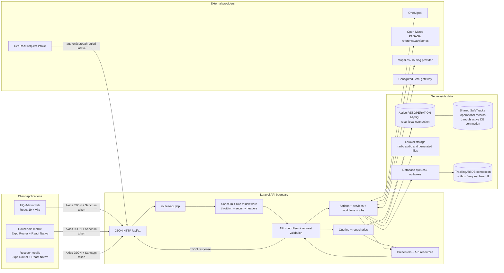

# RESQPERATION System Architecture and File Stack

**Purpose:** Project-tracking reference for the complete current application architecture. File paths are relative to the repository root unless stated otherwise.

**Inventory scope:** Maintained application source, runtime configuration, migrations, tests, and source assets in the primary backend/web/mobile applications. `vendor/`, `node_modules/`, `.git/`, `.expo/`, `dist/`, runtime logs/caches, and compiled bundles are generated or installed outputs and are intentionally not expanded as source files. Never copy secrets from a local `.env` into this document or source control.

## 1. System at a Glance

RESQPERATION is a three-client/API system. HQ/Admin and Super Admin use the React web client. Household residents and rescuers use one Expo React Native app with role-specific screens. All clients call Laravel JSON endpoints under `/api/v1`; only Laravel accesses MySQL and external service credentials.



The diagram is logical: exact providers and connection availability depend on `.env` and deployment configuration. Clients do **not** connect to MySQL. SafeTrack household information is available via the configured/shared operational database; EvaTrack can submit through the external intake API; validated RESQPERATION requests are handed to TrackingAid using the separate `trackingaid` Laravel connection and queued/outbox processing.

## 2. Architecture Rules and Boundaries

- Web and mobile clients call Laravel only; never embed database credentials or query MySQL from a client.
- The active operational database connection is configured in `backend-laravel/.env` and `config/database.php` (`resq_local` by default). Switching the target must not require changing client code.
- `trackingaid` is a separate configured connection for the downstream handoff. Do not confuse it with the primary operational DB.
- API routing is versioned at `/api/v1`. Routes apply authentication, role checks, and throttling at the boundary.
- Controllers coordinate HTTP concerns; queries own read models; actions/workflows/services own write and integration behavior; presenters and API Resources shape the response contract.
- The active database is the source of truth for operational screens. Prototype HTML, generated frontend bundles, SQL proposals, and fixture data are not runtime application logic.
- Database proposals are review artifacts. A schema change must be reviewed and applied under the team's shared-database process.
- Keep API keys, database credentials, signing material, and SMS/OneSignal provider secrets in backend environment configuration. Mobile public config may contain public app identifiers, never server secrets.

## 3. Runtime and Technology Stack

| Layer | Current stack | Repository evidence |
| --- | --- | --- |
| Backend runtime/framework | PHP `^8.3`, Laravel `^13.8` | `resqperation-system/backend-laravel/composer.json` |
| API authentication | Laravel Sanctum `^4.0`, bearer token on mobile/web API calls | `backend-laravel/routes/api.php`, `app/Services/Shared/AuthService.php` |
| Main data store | MySQL-compatible operational DB, active `resq_local` connection | `backend-laravel/config/database.php`, `.env.example` |
| Secondary data store | MySQL-compatible `trackingaid` connection | `backend-laravel/config/database.php` |
| Web client | React `^19.2.6`, Vite `^8.0.12`, React Router DOM `^7.16.0` | `frontend-web/package.json`, `src/App.jsx` |
| Web HTTP/UI/maps/reports | Axios, Leaflet + React Leaflet, Lucide, Chart.js, React PDF, TanStack Table, CSS | `frontend-web/package.json`, `src/api`, `src/components`, `src/styles` |
| Mobile client | Expo `~54.0.37`, React Native `0.81.5`, React `19.1.0`, Expo Router `~6.0.23`, TypeScript `~5.9.2` | `frontend-mobile/package.json`, `app.json` |
| Mobile capabilities | Expo Location, SecureStore, Notifications, Audio, Image Picker, React Native Maps, OneSignal SDK, QR SVG | `frontend-mobile/package.json`, `app.config.js`, `utils/` |
| Backend async processing | Laravel jobs, database queues/outboxes, scheduler | `backend-laravel/app/Jobs`, `routes/console.php`, `composer.json` |
| Backend tests | PHPUnit `^12.5` | `backend-laravel/phpunit.xml`, `tests/` |
| Web checks | ESLint, Vite build | `frontend-web/package.json` |
| Mobile checks | Expo ESLint, TypeScript compiler | `frontend-mobile/package.json`, `tsconfig.json` |

## 4. Request and Data Flow

1. Client app starts: web uses `src/main.jsx` -> `src/App.jsx`; mobile uses Expo Router `app/_layout.tsx` and route files.
2. User authenticates via `POST /api/v1/auth/login`. Backend resolves the database-backed account/role and returns a Sanctum token and user payload.
3. Web saves its API token via `src/api/token.js`; mobile uses `utils/secureStorage.ts` through `api/client.ts`. Authenticated calls send the token to Laravel.
4. Laravel `routes/api.php` selects public, authenticated, and role-restricted route groups. API middleware includes security headers, optional local query profiling, and role alias `role`.
5. Controller validates/coordinates the request, then reads through query/repository classes or mutates through action/service/workflow classes.
6. Presenters and `Illuminate\Http\Resources` classes produce endpoint payloads consumed by web API modules or mobile typed API modules.
7. Operational reads/writes use the active database connection. Side effects such as dispatch/broadcast notifications, weather refresh, reminders, route refresh, and TrackingAid sync use jobs, queues/outboxes, scheduled commands, provider services, and Laravel storage as appropriate.
8. Provider, database, or validation failures are returned as JSON API responses; database connectivity failures are logged with a request ID and reported as `503` by API exception handling.

## 5. Role and Module Ownership Matrix

| Capability | Web entry/pages | Backend route/controller/service surface | Mobile surface |
| --- | --- | --- | --- |
| Login, session, role routing | `frontend-web/src/App.jsx`, `pages/LoginPage.jsx`, `api/authApi.js`, `api/token.js` | `/auth/*`; `AuthController`; `AuthService`; `LoginRequest`; Sanctum and `EnsureUserHasRole` | `app/index.tsx`; `api/auth.ts`; `api/client.ts`; `utils/secureStorage.ts` |
| HQ dashboard and global search | `pages/DashboardPage.jsx`, `components/dashboard/*`, `api/dashboardApi.js`, `api/globalSearchApi.js` | `/dashboard*`, `/global-search`; `DashboardController`, `GlobalSearchController`; `DashboardQuery`, `DashboardService`, `DashboardPresenter`, `DashboardSnapshotResource` | Dashboard/overview data also feeds household/rescuer mobile via role-specific endpoints |
| Disaster events and broadcast | `pages/BroadcastPage.jsx`, `components/broadcast/*`, `api/broadcastApi.js` | `/disaster-events*`; `DisasterBroadcastController`; `DisasterBroadcastQuery`, `DisasterBroadcastService/Workflow`, `DeliverDisasterBroadcast` | Household receives event context/alerts from its overview and OneSignal |
| Weather | `pages/WeatherPage.jsx`, `components/weather/*`, `api/weatherApi.js`, `utils/weatherHelpers.js` | `/weather*`; `WeatherController`; `WeatherService`, `WeatherSnapshotService`, `RefreshWeatherSnapshot`; scheduled `weather:refresh` | Current conditions/event alerts appear in role-specific overview payloads |
| Mapping, geotags, sites, routes | `pages/MappingPage.jsx`, `components/mapping/*`, `api/mappingApi.js`, `utils/mappingHelpers.js`, `utils/boundaryMask.js` | `/map/*`; `MappingController`; `MappingQuery`, `MappingService`, `BarangayBoundaryService`, `RoutingService`, mapping presenters/resources | `components/MobileLeafletMap.*`, `components/rescuer/RescueMapScreen.*`, `components/household/HouseholdRouteScreen.*`, `utils/geocoding.ts` |
| Household status and resident accounts | `pages/HouseholdStatusPage.jsx`, `HouseholdReviewPage.jsx`, `HouseholdPurokListPage.jsx`, `components/households/*`, `api/householdApi.js` | `/households*`; `HouseholdStatusController`; `HouseholdStatusQuery`, status actions/workflows/presenters; mobile routes handled by `HouseholdMobileController` | `app/household/index.tsx`; `components/household/*`; `api/household.ts` |
| Evacuation and check-in | Mapping/household/rescue workflows | `/evacuation/*`; `EvacuationCheckInController`; `EvacuationCheckInService`; evacuation models/resources | Household QR and route screens; rescuer map/check-in flows |
| Rescue dispatch and priority | `pages/RescueDispatchPage.jsx`, `NewDispatchPage.jsx`, `components/dispatch/*`, `api/dispatchApi.js`, `utils/dispatchHelpers.js` | `/dispatches*`, `/rescue-teams`; `RescueDispatchController`; dispatch/priority queries, actions, workflows, presenters, location/route jobs | `app/rescuer/index.tsx`; `RescuerDashboardScreen`, `RescueMapScreen.*`, `api/rescuer.ts` |
| Rescuer accounts and teams | `pages/RescuerAccountsPage.jsx`, `components/rescuers/*`, `api/rescuerApi.js`, `utils/rescuerHelpers.js` | `/rescuers*`; `RescuerAccountController`; account/team queries and services/workflows | Profile/assignment information in rescuer app |
| Resource requests and TrackingAid | `pages/ResourcesRequestsPage.jsx`, `ResourceRequestEditorPage.jsx`, `components/resources/*`, `api/resourceRequestApi.js`, `utils/resourceRequestHelpers.js` | `/resource-requests*`, `/external/resource-requests`; `ResourceRequestController`; request queries/workflows, external intake auth, payload presenter, `SyncTrackingAidRequest` | `components/rescuer/ResourceRequestScreen.tsx`; `api/rescuer.ts` |
| Situation reports | `pages/SituationReportPage.jsx`, `components/situation/*`, `api/situationReportApi.js`, `utils/situationReportHelpers.js` | `/situation-reports*`, event situation summary; `SituationReportController`; query/service/workflow/presenter | Rescuer field reports contribute operational data; no mobile SitRep editor page |
| Archive and exports | `pages/ArchivePage.jsx`, `components/archive/*`, `api/archiveApi.js`, `utils/archiveHelpers.js`, `utils/exportFileHelpers.js` | `/archive/*`; `ArchiveController`; archive queries/services/export/deletion workflows/presenters; streamed exports | No direct mobile archive UI |
| Notifications and device registration | `pages/NotificationsPage.jsx`, `components/notifications/*`, `api/notificationApi.js`, `utils/notificationHelpers.js` | `/notifications*`, `/mobile/device-token`; `NotificationController`, `MobileDeviceController`; `OneSignalNotificationService`, notification jobs/workflow | `utils/pushNotifications.ts`, `api/device.ts`, screen registration lifecycle |
| Profile, security and recovery | `pages/ProfilePage.jsx`, `components/profile/*`, `api/profileApi.js`, `utils/profileHelpers.js` | `/profile*`, `/auth/password-recovery/*`, `/auth/security-questions`; `ProfileController`, `AuthController`; profile query/service/workflow | Role account/profile screens; secure auth/session handling |
| Public inquiries / Super Admin | `pages/SuperAdminPage.jsx`, `api/inquiryApi.js` | Public `POST /inquiries`; restricted inquiry list/update; `InquiryController`, service/query/presenter/resources | Not a mobile module |
| SMS inbound/status | Not a dedicated web page | `/sms/inbound`; `SmsInboundController`; `SmsGatewayService`, household SMS status workflow | Household status can be reported through configured SMS flow |
| Health/readiness | Not a user page | `/health/live`, `/health/ready`; `HealthController`; Laravel `/up` health endpoint | Deployment/monitoring only |

## 6. Backend File Stack

### 6.1 Laravel request layers (`resqperation-system/backend-laravel`)

```text
app/
  Actions/
    SelectDispatchResponders.php
    UpdateHouseholdStatus.php
    UpdateRescuePrioritySettings.php
  Data/
    DashboardSnapshot.php
    InquiryListResult.php
    MappingSnapshot.php
  Http/
    Controllers/Controller.php
    Controllers/Api/
      ArchiveController.php, AuthController.php, DashboardController.php
      DisasterBroadcastController.php, EvacuationCheckInController.php
      GlobalSearchController.php, HealthController.php
      HouseholdMobileController.php, HouseholdStatusController.php
      InquiryController.php, MappingController.php, MobileDeviceController.php
      NotificationController.php, ProfileController.php, RescueDispatchController.php
      RescuerAccountController.php, RescuerMobileController.php
      ResourceRequestController.php, SituationReportController.php
      SmsInboundController.php, WeatherController.php
    Middleware/
      EnsureUserHasRole.php, ProfileLocalQueries.php, SecurityHeaders.php
    Requests/
      ListRequest.php, LoginRequest.php, RescuerAccountPayloadValidator.php
    Resources/
      DashboardSnapshotResource.php, InquiryResource.php, InquiryWorkspaceResource.php
      MappingSnapshotResource.php, MemberCheckResource.php, NotificationFeedResource.php
      ProfileWorkspaceResource.php, RescuePriorityResource.php
      RescuerMobileAdminFieldReportsResource.php
      RescuerMobileAssignmentDetailResource.php, RescuerMobileAssignmentListResource.php
      RescuerMobileAssignmentResource.php, RescuerMobileCheckInResource.php
      RescuerMobileCheckInsResource.php, RescuerMobileEvacuationCenterResource.php
      RescuerMobileEventResource.php, RescuerMobileFieldReportResource.php
      RescuerMobileFieldReportsResource.php, RescuerMobileOverviewResource.php
      RescuerMobileProfileResource.php, RescuerMobileRadioFeedResource.php
      RescuerMobileRadioLogResource.php, RescuerMobileResourceRequestResource.php
      RescuerMobileResourceRequestsResource.php, RescuerMobileResponderResource.php
      RescuerMobileRouteResource.php, RescuerMobileUserResource.php
      UserResource.php, WeatherWorkspaceResource.php, WelfareCheckResource.php
  Jobs/
    DeliverDisasterBroadcast.php, RefreshResponderRoadRoute.php
    RefreshWeatherSnapshot.php, SendDispatchChangePush.php, SendDispatchPush.php
    SendStatusReminder.php, SyncTrackingAidRequest.php
  Models/
    AccommodationType.php, AccommodationUnit.php, Address.php, AffectedArea.php
    AuditLog.php, Barangay.php, BarangayBoundary.php, BarangayProfile.php, City.php
    DeviceToken.php, DeviceTrackingLog.php, DisasterBroadcast.php, DisasterEvent.php
    DisasterType.php, EvacuationCenter.php, EvacuationRecord.php, Gender.php
    GeotaggedLocation.php, Household.php, HouseholdDisaster.php, HouseholdMember.php
    HouseholdStatus.php, HouseholdStatusLog.php, HouseholdTrustedPin.php
    LandingInquiry.php, MemberDisasterStatus.php, MemberStatus.php, Notification.php
    Province.php, Purok.php, Region.php, Relationship.php, RequestValidation.php
    RescuePrioritySetting.php, RescueTeam.php, ResourceRequest.php
    ResourceRequestStatus.php, Responder.php, ResponderAssignment.php
    ResponderLocationLog.php, ResponderRoute.php, Role.php, RouteCoordinate.php
    SeverityLevel.php, Sitio.php, SituationReport.php, StatusReminder.php
    UrgencyLevel.php, User.php, VulnerableGroup.php, WeatherLog.php
  Presenters/
    ArchiveEventPresenter.php, ArchiveExportPresenter.php, ArchivePresenter.php
    DashboardPresenter.php, DisasterBroadcastPresenter.php, HouseholdMobilePresenter.php
    HouseholdStatusPresenter.php, InquiryPresenter.php, MappingPresenter.php
    NotificationPresenter.php, ProfilePresenter.php, RescueCriteriaPresenter.php
    RescueDispatchPresenter.php, RescuerAccountPresenter.php, RescuerAssignmentPresenter.php
    RescuerHouseholdStatusPresenter.php, RescuerRadioPresenter.php
    RescuerResourceRequestPresenter.php, RescuerRoutePresenter.php
    ResourceRequestPresenter.php, SituationReportPresenter.php
    TrackingAidPayloadPresenter.php, UserRolePresenter.php, WeatherSnapshotPresenter.php
  Providers/
    AppServiceProvider.php, RepositoryServiceProvider.php
  Queries/
    ArchiveEventDetailQuery.php, ArchiveQuery.php, AreaCoverageQuery.php
    AuthAccountQuery.php, DashboardQuery.php, DisasterBroadcastQuery.php
    DispatchDestinationQuery.php, HouseholdMobileReadQuery.php, HouseholdPurokQuery.php
    HouseholdStatusQuery.php, InquiryListQuery.php, MappingQuery.php
    NotificationQuery.php, ProfileQuery.php, RescueCriteriaHistoryQuery.php
    RescueCriteriaQuery.php, RescueDispatchQuery.php, RescuePriorityQuery.php
    RescuerAccountQuery.php, RescuerAssignmentQuery.php, RescuerFieldReportQuery.php
    RescuerMobileReadQuery.php, RescuerRadioFeedQuery.php, ResourceRequestMirror.php
    ResourceRequestQuery.php, SitioPriorityQuery.php, SituationReportQuery.php
    UnreportedMemberQuery.php, WelfareCheckQuery.php
  Repositories/
    EloquentRepository.php, HouseholdRepository.php
    Contracts/RepositoryInterface.php
  Services/
    Archive/ArchiveGroupManager.php
    Mobile/
      EvacuationCheckInService.php, HouseholdMemberProfileWorkflow.php
      HouseholdMobileReadWorkflow.php, HouseholdMobileService.php
      HouseholdMobileSetupWorkflow.php, HouseholdMobileStatusWorkflow.php
      HouseholdMobileStatusWriter.php, HouseholdMobileSupport.php
      HouseholdSmsStatusWorkflow.php, HouseholdStatusService.php, HouseholdStatusWorkflow.php
      HouseholdTrustedHouseholdWorkflow.php, MobileDeviceService.php
      RescuerAccountAuditLogger.php, RescuerAccountService.php, RescuerAccountSupport.php
      RescuerAccountWriteWorkflow.php, RescuerAssignmentWorkflow.php
      RescuerCheckInWorkflow.php, RescuerFieldReportWorkflow.php
      RescuerMobileResourceRequestWorkflow.php, RescuerMobileService.php
      RescuerMobileSupport.php, RescuerProfileWorkflow.php, RescuerRadioWorkflow.php
      RescuerRouteWriter.php, RescuerTeamWorkflow.php, RescuerTeamWriteWorkflow.php
    Shared/
      AuthService.php, BarangayBoundaryService.php, BarangayProfileService.php
      ExternalRequestIntakeAuthorization.php, ExternalResourceRequestWorkflow.php
      OneSignalNotificationService.php, OperationalSequence.php, RoutingService.php
      SmsGatewayService.php, StatusReminderScheduler.php, TrackingAidForwardingService.php
      WeatherService.php, WeatherSnapshotService.php
    Web/
      ArchiveDeletionWorkflow.php, ArchiveExportWorkflow.php, ArchiveService.php
      DashboardEventClosureWorkflow.php, DashboardService.php
      DisasterBroadcastRequestValidator.php, DisasterBroadcastService.php
      DisasterBroadcastWorkflow.php, GlobalSearchService.php, InquiryService.php
      MappingService.php, NotificationSavedView.php, NotificationService.php
      NotificationWorkflow.php, ProfileService.php, ProfileWorkflow.php
      RescueDispatchService.php, RescueDispatchWorkflow.php
      ResourceRequestPayloadValidator.php, ResourceRequestService.php
      ResourceRequestWriteWorkflow.php, SituationReportService.php
      SituationReportWorkflow.php
  Support/
    ArchiveGroupPayload.php, QueryProfileRanking.php, RequestQueryProfile.php
    RequestSchema.php, RequestSchemaConnection.php
```

### 6.2 Backend configuration, data, entry points, and tests

```text
backend-laravel/
  artisan                         CLI entry point
  composer.json / composer.lock   PHP dependencies and scripts
  package.json / package-lock.json / vite.config.js  Laravel-owned asset tooling
  phpunit.xml                     PHPUnit configuration
  .env.example                    environment variable template (no local secrets)
  bootstrap/app.php               middleware, API JSON exceptions, health route
  bootstrap/providers.php
  config/                         app, auth, cache, database, filesystems, logging,
                                  mail, map_layers, queue, rescue_priority, sanctum,
                                  services, session, status_reminders
  routes/api.php                  versioned API and role boundaries
  routes/console.php              commands and scheduler cadence
  routes/web.php                  web fallback/hosting routes
  public/index.php                Laravel front controller
  resources/                      Laravel-owned CSS/JS/Blade (not the React source)
  database/factories/UserFactory.php
  database/migrations/            Laravel-managed schema additions and local alignment
  database/migrations/trackingaid/ separate handoff-schema migrations
  database/seeders/                DatabaseSeeder, HqPersonnelSeeder,
                                   RescueTeamRosterSeeder, SampleDisasterStatusSeeder,
                                   TemporaryLoginSeeder, TrackingAidIntegrationSeeder
  database/boundaries/0730600049.geojson
  lang/en/status_reminders.php, lang/en/welfare_check.php
  tests/TestCase.php
  tests/Feature/                    API contracts, workflows, presenters, queries,
                                   integration behavior and health endpoints
  tests/Unit/                       isolated unit tests
```

Current migration files (inventory as present in the repository):

```text
database/migrations/
  0001_01_01_000000_create_users_table.php
  0001_01_01_000001_create_cache_table.php
  0001_01_01_000002_create_jobs_table.php
  2026_05_29_170622_create_personal_access_tokens_table.php
  2026_06_26_000001_create_landing_inquiries_table.php
  2026_08_19_000001_add_account_recovery_fields_to_users_table.php
  2026_08_19_000002_create_password_reset_requests_table.php
  2026_08_19_000003_create_remembered_devices_table.php
  2026_09_07_210029_create_accommodation_types_table.php
  2026_09_07_210414_create_accommodation_units_table.php
  2026_09_24_000001_ensure_personal_access_tokens_table.php
  2026_09_24_000002_fix_personal_access_tokens_schema.php
  2026_09_24_000003_align_resq_local_operational_schema.php
  2026_09_24_000004_align_resq_local_user_links.php
  2026_09_27_000001_add_sms_status_to_disaster_broadcasts.php
  2026_10_02_000001_create_operational_sequences_table.php
  2026_10_02_000002_add_weather_log_read_indexes.php
  2026_10_02_000003_add_sequence_prefix_to_operational_sequences.php
  2026_10_03_000001_create_household_trusted_pins_table.php
  2026_10_04_000001_add_dispatch_responder_count_and_normalize_availability.php
  2026_10_04_000002_create_status_reminders_table.php
  2026_10_04_000003_add_dispatch_type_to_responder_assignments.php
  2026_10_04_000004_create_rescue_priority_settings_table.php
  2026_10_04_000005_create_barangay_boundaries_table.php
  2026_10_04_000006_create_rescue_criteria_snapshots_table.php
  2026_10_04_000007_version_rescue_criteria_snapshots.php
  2026_10_05_000001_create_rescue_criteria_line_snapshots_table.php
  2026_10_05_000002_create_rescue_criteria_contact_baselines_table.php
database/migrations/trackingaid/
  2026_07_02_000001_create_resqperation_forwarded_requests_table.php
  2026_07_02_000002_add_forwarder_columns_to_resqperation_forwarded_requests.php
```

Scheduled work in `routes/console.php`: `weather:refresh` every 3 hours; `status-reminders:schedule` every 5 minutes; `rescue-criteria:capture` every 15 minutes; TrackingAid and operations outbox workers every minute. Deployment must run Laravel's scheduler (for example `php artisan schedule:run` every minute) and ensure both queue/outbox workers or scheduled worker commands are active.

## 7. Web Frontend File Stack

`resqperation-system/frontend-web` is the main HQ/Admin web SPA. `vite.config.js` runs the app on port `5175`, proxies `/api` to Laravel port `8000`, and has a Laravel build mode that outputs to `backend-laravel/public/frontend-web`. The source app is not a Blade UI.

```text
frontend-web/
  package.json, package-lock.json, vite.config.js, eslint.config.js
  .env.example, index.html
  public/favicon.svg, public/icons.svg
  src/main.jsx, src/App.jsx, src/App.css, src/index.css
  src/api/
    archiveApi.js, authApi.js, broadcastApi.js, client.js, dashboardApi.js
    dispatchApi.js, globalSearchApi.js, householdApi.js, inquiryApi.js
    mappingApi.js, notificationApi.js, profileApi.js, rescuerApi.js
    resourceRequestApi.js, situationReportApi.js, token.js, weatherApi.js
  src/pages/
    ArchivePage.jsx, BroadcastPage.jsx, DashboardPage.jsx
    HouseholdPurokListPage.jsx, HouseholdReviewPage.jsx, HouseholdStatusPage.jsx
    LoginPage.jsx, MappingPage.jsx, NewDispatchPage.jsx, NotificationsPage.jsx
    PlaceholderPage.jsx, ProfilePage.jsx, RescueDispatchPage.jsx
    RescuerAccountsPage.jsx, ResourceRequestEditorPage.jsx
    ResourcesRequestsPage.jsx, SituationReportPage.jsx, SuperAdminPage.jsx
    WeatherPage.jsx
  src/components/
    archive/         ArchiveDownloadMenu, ArchiveFilters, ArchiveRecordModal,
                     ArchiveSavedLogsModal, ArchiveSelectionTools, ArchiveTable, ArchiveTabs
    broadcast/       BroadcastComposeForm, BroadcastLifecycleCard, BroadcastSidePanel,
                     BroadcastStartPanel, CloseActiveEventModal
    dashboard/       DashboardCloseEventModal, DashboardMainContent,
                     DashboardOverview, RescueCriteriaChart
    dispatch/        DispatchModalForm, DispatchSidePanel, DispatchStatusBadge,
                     DispatchSummary, DispatchTeamGrid
    households/      HouseholdDetailContent, HouseholdFilters, HouseholdOpsPanels,
                     HouseholdSummary, HouseholdTable, SitioPriorityRanking
    layout/          AppShell, ResQperationLogo, Sidebar, Topbar
    login/           LoginLanding, LoginModal
    mapping/         GeotagToolbar, MappingEventStrip, MappingMap,
                     MappingMapPanels, MappingSidebar, MappingSummary
    notifications/   NotificationList, NotificationSummary, NotificationToolbar
    profile/         DeleteAccountModal, PasswordModal, ProfileEditModal,
                     ProfileIdentity, ProfilePermissionList, ProfileSummary
    rescuers/        RescuerAccountModal, RescuerFilters, RescuerNotice,
                     RescuerRosterTable, RescuerStats, RescuerTeamGrid,
                     RescueTeamConfigModal
    resources/       ResourceRequestFilters, ResourceRequestNotice,
                     ResourceRequestQueueTable, ResourceRequestStats,
                     ResourceValidationModal, TrackingAidMirror
    situation/       SavedSitrepPanel, SitrepGenerateModal, SitrepPdfDocument,
                     SitrepPreview, SituationActionMenu, SituationEventPanel
    ui/              ActionMenu, Badge, Button, DataFilterBar, DataTable,
                     EmptyState, IconButton, LoadingState, Modal, PageHeader,
                     PaginationBar, Panel, RefreshOverlay, StatCard
    weather/         WeatherLivePanel, WeatherMainColumn, WeatherSidebar
  src/styles/
    archive.css, auth.css, broadcast.css, dashboard.css, dispatch.css,
    foundation.css, households.css, index.css, layout.css, main.css,
    map-enhancements.css, mapmate-reference.css, mapping.css, notifications.css,
    operations.css, profile.css, responsive.css, shell.css, situation.css,
    typography.css, ui.css, weather.css, README.md
  src/utils/
    archiveHelpers.js, boundaryMask.js, broadcastHelpers.js, dashboardHelpers.js,
    dispatchHelpers.js, exportFileHelpers.js, householdStatusHelpers.js,
    mappingHelpers.js, notificationHelpers.js, profileHelpers.js, rescuerHelpers.js,
    resourceRequestHelpers.js, situationReportHelpers.js, weatherHelpers.js
  src/assets/ hero.png, react.svg, resqperation-logo.png, vite.svg
```

`src/App.jsx` owns React Router routes, role allowlisting, session restoration, login/logout, lazy-loaded modules, and page metadata. `AppShell` owns authenticated navigation/layout. Module pages orchestrate their feature components and API modules. `src/api/client.js` centralizes base URL, Axios defaults, and auth handling; `token.js` owns web token storage.

### Separate nested project: `frontend-web/safe-route-locator`

This directory has its own `package.json`, Vite config, TanStack Router files, generated `routeTree.gen.ts`, UI component set, and Lovable project metadata. The main `frontend-web/src/App.jsx` route table does not import it. Track it as a separate nested route-locator/design project unless the team explicitly chooses to integrate/deploy it. Its generated files and dependencies are not part of the primary web SPA inventory above.

## 8. Mobile Frontend File Stack

`resqperation-system/frontend-mobile` is one Expo app with role-based entry routing, not two independent mobile apps. The household and rescuer routes share the authenticated API client, secure storage, push registration, theme, and map abstraction.

```text
frontend-mobile/
  package.json, package-lock.json, app.json, app.config.js
  tsconfig.json, eslint.config.js, metro.config.js, eas.json, expo-env.d.ts
  .env.example, README.md, ResQperation-Household-Mobile-Reference.md
  ResQperation-Rescuer-Mobile-Reference.md
  app/
    _layout.tsx, _layout.web.tsx, index.tsx, modal.tsx
    (tabs)/_layout.tsx, (tabs)/index.tsx, (tabs)/explore.tsx
    household/index.tsx, rescuer/index.tsx
  api/
    auth.ts, client.ts, device.ts, household.ts, rescuer.ts
  components/
    MobileLeafletMap.native.tsx, MobileLeafletMap.web.tsx, MobileMapFallback.tsx
    external-link.tsx, haptic-tab.tsx, hello-wave.tsx, hello-wave.web.tsx
    parallax-scroll-view.tsx, parallax-scroll-view.web.tsx, themed-text.tsx, themed-view.tsx
    household/
      HouseholdDashboardScreen.tsx, HouseholdHeader.tsx, HouseholdModals.tsx
      HouseholdProfileScreen.tsx, HouseholdRouteScreen.tsx
      HouseholdRouteScreen.native.tsx, HouseholdRouteScreen.web.tsx
      HouseholdSetupScreen.tsx, HouseholdSetupScreen.native.tsx, HouseholdUI.tsx
    rescuer/
      FieldReportScreen.tsx, RadioCommunicationScreen.tsx
      RescueMapScreen.tsx, RescueMapScreen.native.tsx, RescueMapScreen.web.tsx
      RescuerDashboardScreen.tsx, RescuerHeader.tsx, RescuerUI.tsx
      ResourceRequestScreen.tsx, ResponderProfileScreen.tsx
    ui/collapsible.tsx, ui/icon-symbol.ios.tsx, ui/icon-symbol.tsx
  constants/theme.ts, constants/resqTheme.ts
  hooks/use-color-scheme.ts, hooks/use-color-scheme.web.ts, hooks/use-theme-color.ts
  utils/
    geocoding.ts, mobileDeviceRegistration.ts, mobileLeafletHtml.ts
    mobilePermissions.ts, pushNotifications.ts, secureStorage.ts, time.ts
  assets/images/
    app-icon.png, android-icon-background.png, android-icon-foreground.png
    android-icon-monochrome.png, favicon.png, household-default-profile.jpg
    icon.png, partial-react-logo.png, react-logo.png, redacted@example.invalid
    redacted@example.invalid, resqperation-logo-transparent.png, resqperation-logo.png
    splash-icon.png
  android/                         checked-in native Android project/config
```

The checked-in `android/` subtree contains Gradle wrapper/settings and build properties, app Gradle config, Android manifests, Kotlin `MainActivity.kt`/`MainApplication.kt`, native resource XML and launcher/splash image variants. These files matter for OneSignal, permissions, package identity, and native Google Maps setup; generated Gradle build output and keystores must be handled as build/signing material, not source inventory. There is no separate iOS native source tree in the maintained file map above; iOS builds/configuration are driven by Expo/EAS unless native files are added.

Mobile routing: `app/index.tsx` is login/session role dispatch; `app/household/index.tsx` and `app/rescuer/index.tsx` are role shells/screens. Shared app layout installs navigation theme and notification handler. `.native.tsx` and `.web.tsx` select platform implementations. Secure token/device identifiers are stored locally; feature data remains server-backed.

## 9. API Surface and Authorization Map

Every path below is prefixed with `/api/v1` unless noted. `routes/api.php` is the authoritative live route list.

| Route group | Representative endpoints | Access boundary |
| --- | --- | --- |
| Health/version | `GET /`, `GET /health/live`, `GET /health/ready` | Public |
| Public intake | `POST /inquiries`, `POST /external/resource-requests`, `POST /sms/inbound` | Public with per-route throttling and endpoint-specific intake validation/authorization |
| Login/recovery | `POST /auth/login`, `GET /auth/password-recovery/questions`, `POST /auth/password-recovery/reset` | Public with stricter throttles |
| Shared authenticated | `GET /auth/me`, `POST /auth/logout`, security questions | Sanctum token; common authenticated throttle |
| HQ/Admin operations | dashboard, global search, notifications, profile, disasters/broadcasts, weather, maps, households, teams/dispatch, rescuers, resource requests, SitReps, archives, inquiries | `role:super_admin,admin` on HQ management groups |
| Household/rescuer common | push device token, household status log | `role:household_resident,rescuer` |
| Household mobile | `/household/overview`, setup, device location, member/status, status history, QR, trusted-household/pin | `role:household_resident` |
| Shared evacuation | evacuation QR verify/check-in; dispatch updates | Admin/rescuer roles as declared on individual groups |
| Rescuer mobile | profile, overview, assignments/status/location, field reports, check-ins, requests, radio feed/transmission/clip/signal | `role:rescuer` |

Detailed route families include:

- Dashboard: `/dashboard`, `/dashboard/summary`, `/dashboard/dispatch`, `/dashboard/weather`, `/dashboard/requests`, `/dashboard/activity`, `/dashboard/active-event/close`.
- Disasters: `/disaster-events`, event detail/update, event broadcasts, event weather logs, event situation summary.
- Household/mapping: `/households`, household detail/status logs/confirm; `/map/overview`, `/map/workspace`, geotags, evacuation sites, dispatch routes; `/evacuation/check-in`, `/evacuation/verify-qr`.
- Dispatch: `/rescue-teams`, `/dispatches`, welfare/member-check/priority/settings/timeline, create/detail/update/complete/location.
- Rescuer accounts: `/rescuers`, team config CRUD, responder create/detail/update/deactivate.
- Resource requests: list/create/detail/update/validate/forward/return/complete, plus public external intake.
- SitRep/archive: reports list/create/detail/PDF; archive events, status logs, dispatch logs, radio logs, requests, SitReps, export, saved groups and selected-record deletion.
- Household mobile: setup, location, household/member status, history, QR, trusted households and PIN controls.
- Rescuer mobile: assignments, location/status, field reports, check-ins, requests, radio start/heartbeat/stop/clip/signal.

## 10. Data and External Integration Boundaries

- **Operational DB:** backend's default `resq_local` connection points to the current local or shared database according to environment configuration. Users, roles, households, responders, disaster operations, logs, reporting, and app state are DB-backed.
- **TrackingAid:** separate `trackingaid` connection and dedicated migrations for forwarded-request handoff records. Request creation/validation/forwarding is recorded and asynchronous sync is supported by outbox/queue jobs.
- **SafeTrack:** household account/household information is shared through the configured operational database; it is not a direct mobile-to-SafeTrack connection.
- **EvaTrack:** can submit request records to the throttled external resource-request endpoint. Backend authorizes/validates and normalizes the payload.
- **Weather:** Laravel fetches and snapshots Open-Meteo data. PAGASA is treated as official warning/advisory reference; HQ verifies official warnings before publishing a broadcast. Frontend pages read API snapshots rather than calling weather providers directly.
- **OneSignal:** Expo native SDK obtains/maintains mobile subscription/device details; authenticated mobile API registers them; Laravel sends push messages. Expo Go cannot validate native SDK behavior; use a real dev/production build and real credentials for end-to-end QA.
- **Mapping/routing:** web Leaflet and mobile native/web platform-specific map components render map experiences. Laravel owns geospatial operational data and route-service orchestration. Map tiles/routing provider credentials and network reachability are deployment concerns.
- **SMS:** inbound route and gateway abstraction are backend-owned; provider credentials stay server-side.
- **Files:** Laravel storage handles uploaded/recorded radio clips and generated/export artifacts according to configured filesystems. Confirm production storage persistence and access policy separately.

## 11. Repository-Level File Stack

```text
repository root
  README.md
  data.sql, full_schema.sql                 database snapshots/reference SQL
  docs/                                      maintained requirements, plans, checks,
                                             integrations, diagrams and SQL proposals
  resqperation-system/
    README.md
    backend-laravel/                         Laravel JSON API and server runtime
    frontend-web/                            React/Vite HQ/Admin SPA
    frontend-mobile/                         Expo household/rescuer application
  FOR DEV/, prototype/, .sixth/, .dist/, .claude/
                                             local/reference-only; not deployable source
```

`docs/sql_proposals/` contains review proposals/historical SQL. Root SQL dumps are reference snapshots, not a replacement for the active database or reviewed migrations. Use this architecture inventory and the live source directories as the tracker baseline; regenerate any file-tree snapshot when one is needed.

## 12. Project Tracking Checklist

Use these checkboxes as a working baseline. `[x]` means source/configuration exists in the current repository, **not** that production readiness or end-to-end acceptance has been signed off. Tick validation items only after the team records the environment/build/account used.

### Platform foundations

- [x] Three application boundaries identified: API, web SPA, role-based mobile app.
- [x] Versioned JSON API and Sanctum auth present.
- [x] Role gates for admin, household resident, and rescuer routes present.
- [x] Active operational DB and secondary TrackingAid connection configured in Laravel.
- [x] Main web dev proxy/build-to-Laravel path configured.
- [x] Mobile native Android config and EAS profiles present.
- [ ] Record production hosting topology, DNS/TLS, secrets manager, backups, and recovery owner.
- [ ] Verify least-privilege database users and production environment variables.
- [ ] Agree on migration approval, backup, rollback, and release checklist with DB owner.

### Backend/API

- [x] Auth, recovery, role middleware, health endpoints, and JSON exception handling present.
- [x] Web operational modules and mobile household/rescuer API families present.
- [x] Query/action/service/workflow/presenter/resource layers present.
- [x] Jobs, database queue/outbox connections, and scheduler commands present.
- [ ] Run `php artisan test` against an isolated test DB and attach result/date.
- [ ] Verify `php artisan route:list` against this route-family inventory after API changes.
- [ ] Run health live/ready checks against local and intended deployment DB.
- [ ] Validate queue workers, scheduler cadence, retries, failed-job handling, and outbox replay.
- [ ] Validate external resource intake authentication/rate limits with partner test payloads.
- [ ] Verify upload/audio storage permissions, limits, retention, and production persistence.

### Web frontend

- [x] Login, role-gated routes, shell/navigation, operational pages, and API modules present.
- [x] Loading/error/empty states and shared UI component library present in source.
- [ ] Run `npm run lint` from `frontend-web/` and record result/date.
- [ ] Run `npm run build` and test SPA navigation/refresh behavior on the target host.
- [ ] Run `npm run build:laravel` and verify the Laravel-served `/frontend-web/` assets/API routing.
- [ ] Smoke-test every module against a non-fixture database and confirm displayed records match the active DB.
- [ ] Verify map tiles, report/PDF output, archive export, responsive layouts, and browser permissions.
- [ ] Decide whether the nested `safe-route-locator` project is archived, maintained separately, or integrated.

### Mobile

- [x] Shared auth/API layer, secure storage, household route and rescuer route present.
- [x] Household setup/status/history/QR/trusted-household and location/device data flows present.
- [x] Rescuer assignments/map/status/location/report/resource/radio flows present.
- [x] Push-registration, platform map variants, permissions, and native project configuration present.
- [ ] Run `npx tsc --noEmit` from `frontend-mobile/` and record result/date.
- [ ] Run `npm run lint` from `frontend-mobile/` and record result/date.
- [ ] Test household and rescuer flows on physical Android/iOS devices with production-like API host.
- [ ] Test native OneSignal receive/open/token refresh using a development or production build.
- [ ] Verify Google Maps API key restrictions and native map rendering on Android release build.
- [ ] Verify location permission denial, offline/network failure, battery reporting, and device replacement.
- [ ] Verify radio/audio capture, upload, playback, permissions, and retention on target devices.

### Integrations/data/security/operations

- [x] Backend abstractions/routes exist for OneSignal, weather, mapping/routing, SMS, EvaTrack intake, TrackingAid handoff.
- [ ] Confirm provider credentials, quotas, restrictions, and alert ownership for each deployment.
- [ ] Verify TrackingAid handoff idempotency, retry/reconciliation, and receipt with partner DB owner.
- [ ] Verify SafeTrack shared-schema compatibility and read/write ownership with DB owner.
- [ ] Verify backup/restore, retention, audit log access, incident response, and operational monitoring.
- [ ] Perform end-to-end user-role and disaster drill acceptance; attach test evidence and sign-off.

## 13. Verification Commands

Run from each named application folder:

```powershell
# Laravel API
cd resqperation-system/backend-laravel
php artisan test
php artisan route:list
php artisan schedule:list

# Web SPA
cd ../frontend-web
npm run lint
npm run build
npm run build:laravel

# Mobile app
cd ../frontend-mobile
npx tsc --noEmit
npm run lint
```

For integration QA, start Laravel on a phone-reachable interface (`php artisan serve --host=0.0.0.0 --port=8000`), use the current LAN API base URL in the mobile environment, and test native-only SDK behavior in an installed development build. Do not use Expo Go as evidence of OneSignal-native delivery.

## 14. Architecture Change Checklist

For every new module or architectural change, update the relevant code and this inventory together:

- [ ] Add/adjust API route and role/throttle policy.
- [ ] Add request validation, controller orchestration, query/write workflow, and response resource/presenter as appropriate.
- [ ] Add/adjust model/schema/migration only after DB owner review; update SQL/schema notes.
- [ ] Add frontend/mobile API method and page/screen/component ownership entry.
- [ ] Add focused automated tests for endpoint contract, authorization, workflow, and integration failures.
- [ ] Add provider/env documentation without secrets; record required deployment configuration.
- [ ] Update module matrix, file stack, route-family summary, and acceptance checklist here.
- [ ] Run focused tests/build/lint and record manual external/device QA separately.
