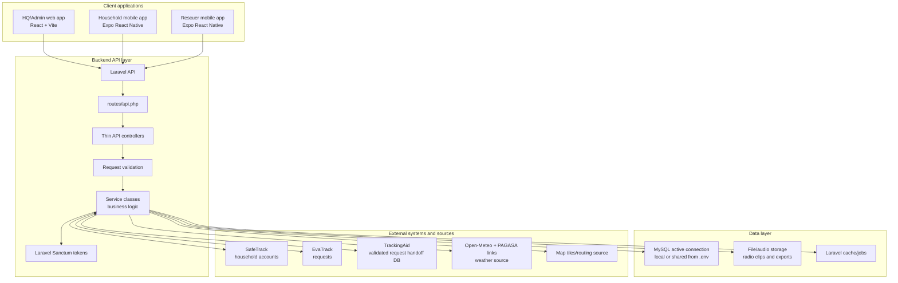

# 18 - System Architecture

## Architecture rules

- Only `backend-laravel/.env` should change when switching the active operational database connection.
- TrackingAid uses a separately configured Laravel DB connection for forwarded-request handoff.
- Web and mobile clients must call the API, not the database directly.
- Controllers coordinate HTTP concerns and delegate logic to services.
- Pages should display active database records only.

See [RESQPERATION_SYSTEM_ARCHITECTURE_FILE_STACK.md](../RESQPERATION_SYSTEM_ARCHITECTURE_FILE_STACK.md) for the complete file inventory, endpoint families, module ownership matrix, and team tracking checklist.

