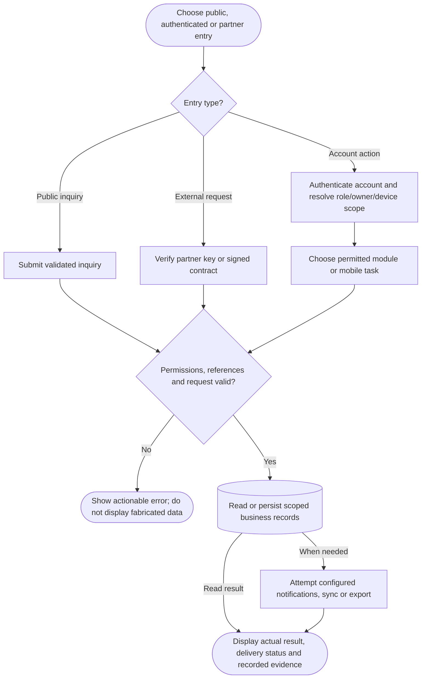

# Full-system operational flow

Branches are alternatives, not a claim that every transaction runs every module. Human sessions, public inquiry intake and partner credentials are different trust boundaries. Lanes identify responsibility; arrows identify control/handoff rather than database foreign keys.

## Use cases and responsibilities

| ID | Goal | Primary actor / permitted baseline role | Result / important condition |
|---|---|---|---|
| UC-01 | Sign in, resume access and sign out | Chairperson, Operations / Admin, Mitigation / Prevention, Preparedness, Response personnel, Recovery / Rehabilitation, Household resident, Rescuer team leader, Rescuer team member | An authenticated, role-scoped session or a clear rejection. Household owner selection and mobile device binding can restrict the session before operational actions. |
| UC-02 | Maintain own profile and password | Chairperson, Operations / Admin, Mitigation / Prevention, Preparedness, Response personnel, Recovery / Rehabilitation, Household resident, Rescuer team leader, Rescuer team member | Permitted personal fields or credentials updated. These are role-specific entry points, not permission for every actor to call every listed route. |
| UC-03 | Recover account access | Chairperson, Operations / Admin, Mitigation / Prevention, Preparedness, Response personnel, Recovery / Rehabilitation, Household resident, Rescuer team leader, Rescuer team member | Verified recovery resets credentials. Security-question recovery and household SMS recovery are different branches; configured contact data, expiry and throttles apply. |
| UC-04 | Manage rescuer accounts and teams | Operations / Admin | Validated account/team changes with audit evidence. Personnel access is currently Operations/Admin; a team leader is not automatically a personnel administrator. |
| UC-05 | Manage HQ accounts and roles | Operations / Admin | Account roles and permitted capabilities configured. Role configuration remains bounded by the server policy. |
| UC-06 | Maintain barangay operational profile | Operations / Admin | Authorized profile data updated.  |
| UC-07A | Submit a public inquiry | Public visitor | Validated inquiry stored in landing_inquiries. Public submission does not grant staff review access. |
| UC-07B | Review and archive inquiries | Operations / Admin | Staff handling state and history recorded.  |
| UC-08 | Select phone owner and complete household setup | Household resident | Current phone is linked to an authorized household member and setup/geotag. Pending-owner tokens cannot perform ordinary household actions. Existing registered Android/iOS platform is preserved. |
| UC-09 | Receive and review disaster alerts | Household resident, Rescuer team leader, Rescuer team member | App reads stored alerts; eligible devices can receive provider pushes. Notification permission, native build, subscription and network availability are required for push delivery. |
| UC-10 | Report household or member safety | Household resident | Authorized status/history records updated. Use the active event and actual configured database/broadcast status choices. |
| UC-11 | Connect and assist a trusted household | Household resident | A permitted trusted connection can report scoped member status. A household ID alone is insufficient: connection state and PIN/permission checks apply. |
| UC-12 | View evacuation information and available directions | Household resident | Available site/map information is displayed. Availability of directions depends on the implemented client, location/provider data and connectivity; do not infer a dedicated household route API. |
| UC-13A | Display household verification QR | Household resident | Household verification information displayed.  |
| UC-13B | Verify evacuation arrival | Chairperson, Operations / Admin, Mitigation / Prevention, Preparedness, Response personnel, Recovery / Rehabilitation, Rescuer team leader, Rescuer team member | Authorized verification/check-in updates shared evacuation evidence. Backend verifier access is supported; a dedicated scanner account role or complete staff scanning UI is not established by these routes. |
| UC-14 | View saved household information offline | Household resident | An available account-scoped cached overview can be shown. Current useMobileOverview/mobileSnapshot supports cached reading. This does not establish durable offline household status submission. |
| UC-15 | View own assigned incidents and households | Rescuer team leader, Rescuer team member | Only the authorized rescuer assignment/household scope is returned.  |
| UC-16 | Navigate and update assigned mission progress | Rescuer team leader, Rescuer team member | Permitted route, progress and foreground location updates recorded. Active-event, assignment ownership, household queue and valid transition rules apply. Mobile completion is not equivalent to the HQ approval endpoint. |
| UC-17 | Use saved navigation and synchronize trip events | Rescuer team leader, Rescuer team member | Supported local trip events receive server acknowledgments after reconnect. Conditional on native storage, valid cached route/pack and device binding. Never generalize this outbox to every mobile write. |
| UC-18 | Record check-in and member assessment | Rescuer team leader, Rescuer team member | Scoped field/check-in evidence recorded.  |
| UC-19 | Submit field findings and damage assessment | Rescuer team leader, Rescuer team member | Validated report header, member assessment and catalog damage choice stored. Actual database keys/labels, assignment/event scope and retry protections are used. |
| UC-20A | Communicate using internet PTT and clips | Rescuer team leader, Rescuer team member | Internet radio activity and playable clip references recorded. Requires connectivity and microphone access. It is not offline hardware radio; audio files are outside MySQL. |
| UC-20B | Monitor rescue communications | Chairperson, Operations / Admin, Response personnel | Authorized HQ can review operational communication metadata.  |
| UC-21A | Submit a field logistics request | Rescuer team leader | Persisted request awaits HQ validation. Submission is team-leader-only. Base rescuer identity alone does not grant this POST action. |
| UC-21B | Track or cancel an eligible own request | Rescuer team leader, Rescuer team member | Own request state shown or an allowed cancellation recorded. Ownership and current state limit cancellation. |
| UC-22A | Monitor dashboard and operational summaries | Chairperson, Operations / Admin, Mitigation / Prevention, Preparedness, Response personnel, Recovery / Rehabilitation | Charts/KPIs derive from selected operational database records.  |
| UC-22B | Review maps, directory and weather | Chairperson, Operations / Admin, Mitigation / Prevention, Preparedness, Response personnel, Recovery / Rehabilitation | Authorized geography/safety/weather data displayed.  |
| UC-23A | Declare a disaster and publish alert instructions | Chairperson, Operations / Admin | Event/alert saved; actual provider delivery state recorded. Publishing is Chairperson/Operations-Admin under current policy. A saved alert can still have no recipients or provider failure; only accepted messages have provider IDs. |
| UC-23B | Review, update and close an active event | Chairperson, Operations / Admin, Response personnel | Permitted event lifecycle change recorded. Close/review/update follow their actual route actions; do not assume all publication permissions are identical. |
| UC-24 | Review severity and hazard overlays | Chairperson, Operations / Admin, Mitigation / Prevention, Preparedness, Response personnel, Recovery / Rehabilitation | Stored severity/hazard evidence displayed. This use case does not claim an implemented arbitrary area-drawing or hazard-edit UI. |
| UC-25A | Review household safety reports | Chairperson, Operations / Admin, Mitigation / Prevention, Preparedness, Response personnel, Recovery / Rehabilitation | Household safety data shown within geographic scope.  |
| UC-25B | Confirm a household status report | Chairperson, Operations / Admin, Response personnel | Authorized operational confirmation recorded.  |
| UC-26A | Inspect rescue priorities and historical criteria | Chairperson, Operations / Admin, Response personnel | Database-backed priorities and versioned evidence displayed.  |
| UC-26B | Dispatch a rescue team | Chairperson, Operations / Admin, Response personnel | Validated assignment targets and team/responder scope saved.  |
| UC-26C | Complete a dispatch through HQ approval | Chairperson, Operations / Admin | Permitted HQ completion recorded. HQ completion is an approve action, distinct from rescuer household-queue progress. |
| UC-27 | Monitor field reports and team progress | Chairperson, Operations / Admin, Response personnel | HQ operational progress/evidence displayed.  |
| UC-28 | Prepare, save and export a situation report | Chairperson, Operations / Admin, Mitigation / Prevention, Preparedness, Response personnel, Recovery / Rehabilitation | Report created/exported from recorded data and operator inputs.  |
| UC-29 | Export findings for manual escalation | Chairperson, Operations / Admin, Mitigation / Prevention, Preparedness, Response personnel, Recovery / Rehabilitation | Exported document available for manual handoff. File export does not establish automatic transmission to every higher-level authority. |
| UC-30 | Browse, export and manage scoped archive evidence | Chairperson, Operations / Admin, Mitigation / Prevention, Preparedness, Response personnel, Recovery / Rehabilitation | Authorized archive evidence reviewed or managed. Use record IDs, source validation and recording availability. Destructive actions still require their own validation/confirmation. |
| UC-31 | Submit an external resource request | Authorized request partner | Authenticated partner request enters the persisted workflow. Partner authentication/contract validation is separate from human sign-in. |
| UC-32A | Review and record resource requests | Chairperson, Operations / Admin, Response personnel, Recovery / Rehabilitation | Authorized workspace or request record returned.  |
| UC-32B | Validate, return or complete a resource request | Chairperson, Operations / Admin | Validation decision/history/status saved. Module visibility does not confer approval. Status labels come from actual lookup records. |
| UC-33 | Forward a validated request and monitor fulfillment | Chairperson, Operations / Admin | Partner handoff/reference and actual fulfillment evidence recorded. Partner connectivity/acknowledgment is conditional. Forwarded does not mean delivered. |
| UC-34A | Request a Resqperation report | SafeTrack report service, EvaTrack report service, TrackingAid | Valid partner contract creates a pending report request. Current ReportExchangeController requires contract v4.0 with permitted event, sitio, sections and format. |
| UC-34B | Decide report release and generate a signed file | Chairperson, Operations / Admin, Mitigation / Prevention, Preparedness, Response personnel, Recovery / Rehabilitation | Accepted snapshot/file or rejection reason persisted. This is governed by the reports module, not automatically the resource-request approve permission. |
| UC-35 | Request and review a partner report | Chairperson, Operations / Admin, Mitigation / Prevention, Preparedness, Response personnel, Recovery / Rehabilitation | Available partner report returned or explicit provider error.  |
| UC-36 | Export selected situation findings | Chairperson, Operations / Admin, Mitigation / Prevention, Preparedness, Response personnel, Recovery / Rehabilitation | Permitted sections exported in the implemented format.  |
| UC-37 | Register a permitted mobile push subscription | Household resident, Rescuer team leader, Rescuer team member | Real subscription/permission/identity saved on the active backend. Native SDK registration and consent required. Legacy mobile platforms are used for Android only after provider verification. |
| UC-38 | Report safety through a configured SMS gateway | Household resident | A verified sender can record supported event status. Gateway signature/timestamp, matching household contact, active event and supported keyword are required. |
| UC-39 | Review notifications and enable browser push | Chairperson, Operations / Admin, Mitigation / Prevention, Preparedness, Response personnel, Recovery / Rehabilitation | Authorized web notifications or browser subscription updated. Browser push uses VAPID/service-worker configuration and HTTPS requirements; it is separate from mobile OneSignal. |

[Raw Mermaid](02_full_process_flow.mmd) | [Package index](../00_README.md) | [Current case catalog](../06_REFERENCE/01_current_use_case_catalog.md)
