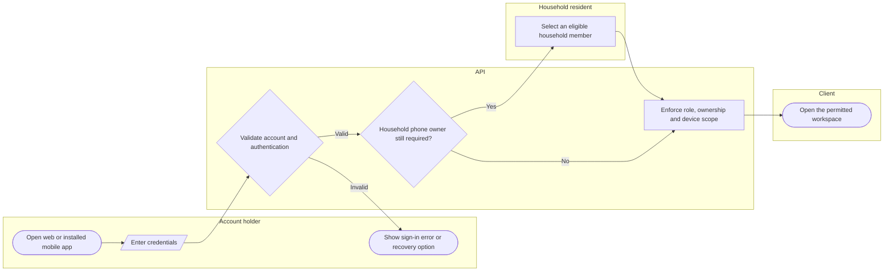

# Authenticate and enter the correct workspace

 Lanes identify responsibility; arrows identify control/handoff rather than database foreign keys.

## Use cases and responsibilities

| ID | Goal | Primary actor / permitted baseline role | Result / important condition |
|---|---|---|---|
| UC-01 | Sign in, resume access and sign out | Chairperson, Operations / Admin, Mitigation / Prevention, Preparedness, Response personnel, Recovery / Rehabilitation, Household resident, Rescuer team leader, Rescuer team member | An authenticated, role-scoped session or a clear rejection. Household owner selection and mobile device binding can restrict the session before operational actions. |
| UC-03 | Recover account access | Chairperson, Operations / Admin, Mitigation / Prevention, Preparedness, Response personnel, Recovery / Rehabilitation, Household resident, Rescuer team leader, Rescuer team member | Verified recovery resets credentials. Security-question recovery and household SMS recovery are different branches; configured contact data, expiry and throttles apply. |
| UC-08 | Select phone owner and complete household setup | Household resident | Current phone is linked to an authorized household member and setup/geotag. Pending-owner tokens cannot perform ordinary household actions. Existing registered Android/iOS platform is preserved. |
| UC-37 | Register a permitted mobile push subscription | Household resident, Rescuer team leader, Rescuer team member | Real subscription/permission/identity saved on the active backend. Native SDK registration and consent required. Legacy mobile platforms are used for Android only after provider verification. |

[Raw Mermaid](01_access_swimlane.mmd) | [Package index](../00_README.md) | [Current case catalog](../06_REFERENCE/01_current_use_case_catalog.md)
