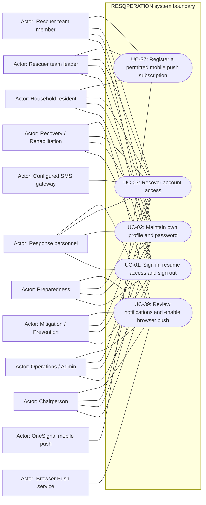

# Access, recovery and notification registration — use cases

Mermaid has no native UML use-case diagram. Actor boxes, oval goals and the system boundary form an explicitly UML-style view; association lines are not a process sequence. Supporting providers are external actors, not additional staff roles.

## Use cases and responsibilities

| ID | Goal | Primary actor / permitted baseline role | Result / important condition |
|---|---|---|---|
| UC-01 | Sign in, resume access and sign out | Chairperson, Operations / Admin, Mitigation / Prevention, Preparedness, Response personnel, Recovery / Rehabilitation, Household resident, Rescuer team leader, Rescuer team member | An authenticated, role-scoped session or a clear rejection. Household owner selection and mobile device binding can restrict the session before operational actions. |
| UC-02 | Maintain own profile and password | Chairperson, Operations / Admin, Mitigation / Prevention, Preparedness, Response personnel, Recovery / Rehabilitation, Household resident, Rescuer team leader, Rescuer team member | Permitted personal fields or credentials updated. These are role-specific entry points, not permission for every actor to call every listed route. |
| UC-03 | Recover account access | Chairperson, Operations / Admin, Mitigation / Prevention, Preparedness, Response personnel, Recovery / Rehabilitation, Household resident, Rescuer team leader, Rescuer team member | Verified recovery resets credentials. Security-question recovery and household SMS recovery are different branches; configured contact data, expiry and throttles apply. |
| UC-37 | Register a permitted mobile push subscription | Household resident, Rescuer team leader, Rescuer team member | Real subscription/permission/identity saved on the active backend. Native SDK registration and consent required. Legacy mobile platforms are used for Android only after provider verification. |
| UC-39 | Review notifications and enable browser push | Chairperson, Operations / Admin, Mitigation / Prevention, Preparedness, Response personnel, Recovery / Rehabilitation | Authorized web notifications or browser subscription updated. Browser push uses VAPID/service-worker configuration and HTTPS requirements; it is separate from mobile OneSignal. |

[Raw Mermaid](01_access_use_cases.mmd) | [Package index](../00_README.md) | [Current case catalog](../06_REFERENCE/01_current_use_case_catalog.md)
