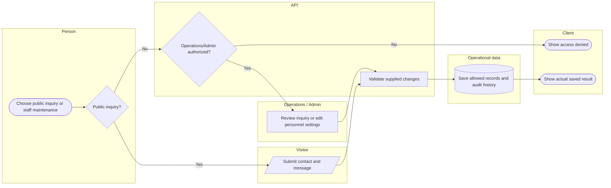

# Restricted administration and public inquiry intake

 Lanes identify responsibility; arrows identify control/handoff rather than database foreign keys.

## Use cases and responsibilities

| ID | Goal | Primary actor / permitted baseline role | Result / important condition |
|---|---|---|---|
| UC-04 | Manage rescuer accounts and teams | Operations / Admin | Validated account/team changes with audit evidence. Personnel access is currently Operations/Admin; a team leader is not automatically a personnel administrator. |
| UC-05 | Manage HQ accounts and roles | Operations / Admin | Account roles and permitted capabilities configured. Role configuration remains bounded by the server policy. |
| UC-06 | Maintain barangay operational profile | Operations / Admin | Authorized profile data updated.  |
| UC-07A | Submit a public inquiry | Public visitor | Validated inquiry stored in landing_inquiries. Public submission does not grant staff review access. |
| UC-07B | Review and archive inquiries | Operations / Admin | Staff handling state and history recorded.  |

[Raw Mermaid](02_administration_swimlane.mmd) | [Package index](../00_README.md) | [Current case catalog](../06_REFERENCE/01_current_use_case_catalog.md)
