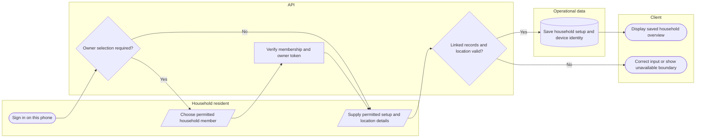

# Household owner, setup and geotag

Location/setup must preserve a known Android/iOS registration. Cached reading does not prove offline status submission. Lanes identify responsibility; arrows identify control/handoff rather than database foreign keys.

## Use cases and responsibilities

| ID | Goal | Primary actor / permitted baseline role | Result / important condition |
|---|---|---|---|
| UC-08 | Select phone owner and complete household setup | Household resident | Current phone is linked to an authorized household member and setup/geotag. Pending-owner tokens cannot perform ordinary household actions. Existing registered Android/iOS platform is preserved. |
| UC-12 | View evacuation information and available directions | Household resident | Available site/map information is displayed. Availability of directions depends on the implemented client, location/provider data and connectivity; do not infer a dedicated household route API. |
| UC-13A | Display household verification QR | Household resident | Household verification information displayed.  |
| UC-14 | View saved household information offline | Household resident | An available account-scoped cached overview can be shown. Current useMobileOverview/mobileSnapshot supports cached reading. This does not establish durable offline household status submission. |

[Raw Mermaid](03_household_setup_swimlane.mmd) | [Package index](../00_README.md) | [Current case catalog](../06_REFERENCE/01_current_use_case_catalog.md)
