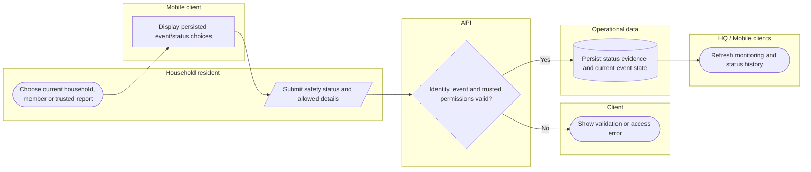

# Record an authorized household or member safety report

SMS enters through a separately signed gateway path, not an unrestricted alternate login. Lanes identify responsibility; arrows identify control/handoff rather than database foreign keys.

## Use cases and responsibilities

| ID | Goal | Primary actor / permitted baseline role | Result / important condition |
|---|---|---|---|
| UC-10 | Report household or member safety | Household resident | Authorized status/history records updated. Use the active event and actual configured database/broadcast status choices. |
| UC-11 | Connect and assist a trusted household | Household resident | A permitted trusted connection can report scoped member status. A household ID alone is insufficient: connection state and PIN/permission checks apply. |
| UC-25A | Review household safety reports | Chairperson, Operations / Admin, Mitigation / Prevention, Preparedness, Response personnel, Recovery / Rehabilitation | Household safety data shown within geographic scope.  |
| UC-38 | Report safety through a configured SMS gateway | Household resident | A verified sender can record supported event status. Gateway signature/timestamp, matching household contact, active event and supported keyword are required. |

[Raw Mermaid](04_safety_swimlane.mmd) | [Package index](../00_README.md) | [Current case catalog](../06_REFERENCE/01_current_use_case_catalog.md)
