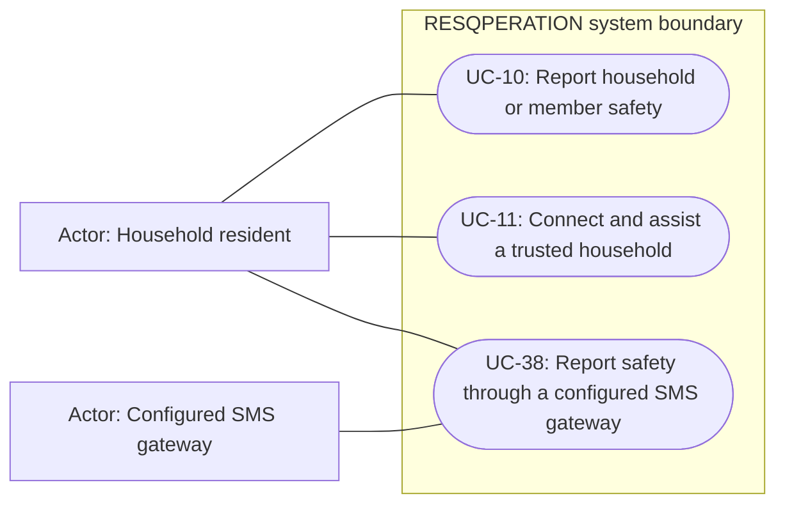

# Household safety, trusted reporting and SMS — use cases

Mermaid has no native UML use-case diagram. Actor boxes, oval goals and the system boundary form an explicitly UML-style view; association lines are not a process sequence. Supporting providers are external actors, not additional staff roles.

## Use cases and responsibilities

| ID | Goal | Primary actor / permitted baseline role | Result / important condition |
|---|---|---|---|
| UC-10 | Report household or member safety | Household resident | Authorized status/history records updated. Use the active event and actual configured database/broadcast status choices. |
| UC-11 | Connect and assist a trusted household | Household resident | A permitted trusted connection can report scoped member status. A household ID alone is insufficient: connection state and PIN/permission checks apply. |
| UC-38 | Report safety through a configured SMS gateway | Household resident | A verified sender can record supported event status. Gateway signature/timestamp, matching household contact, active event and supported keyword are required. |

[Raw Mermaid](04_safety_use_cases.mmd) | [Package index](../00_README.md) | [Current case catalog](../06_REFERENCE/01_current_use_case_catalog.md)
