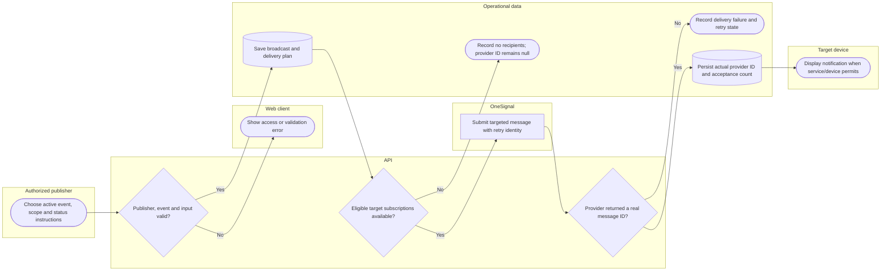

# Save an alert and record actual OneSignal delivery

Accepted is not proof of device display. OneSignal message IDs cannot be fabricated for failed or untargeted messages; optional SMS has independent delivery status. Lanes identify responsibility; arrows identify control/handoff rather than database foreign keys.

## Use cases and responsibilities

| ID | Goal | Primary actor / permitted baseline role | Result / important condition |
|---|---|---|---|
| UC-09 | Receive and review disaster alerts | Household resident, Rescuer team leader, Rescuer team member | App reads stored alerts; eligible devices can receive provider pushes. Notification permission, native build, subscription and network availability are required for push delivery. |
| UC-23A | Declare a disaster and publish alert instructions | Chairperson, Operations / Admin | Event/alert saved; actual provider delivery state recorded. Publishing is Chairperson/Operations-Admin under current policy. A saved alert can still have no recipients or provider failure; only accepted messages have provider IDs. |
| UC-23B | Review, update and close an active event | Chairperson, Operations / Admin, Response personnel | Permitted event lifecycle change recorded. Close/review/update follow their actual route actions; do not assume all publication permissions are identical. |
| UC-37 | Register a permitted mobile push subscription | Household resident, Rescuer team leader, Rescuer team member | Real subscription/permission/identity saved on the active backend. Native SDK registration and consent required. Legacy mobile platforms are used for Android only after provider verification. |

[Raw Mermaid](05_alerts_swimlane.mmd) | [Package index](../00_README.md) | [Current case catalog](../06_REFERENCE/01_current_use_case_catalog.md)
