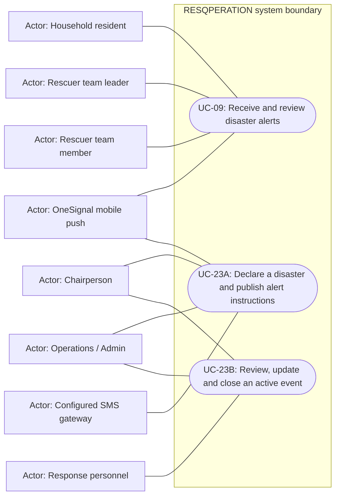

# Disaster lifecycle and broadcast delivery — use cases

Mermaid has no native UML use-case diagram. Actor boxes, oval goals and the system boundary form an explicitly UML-style view; association lines are not a process sequence. Supporting providers are external actors, not additional staff roles.

## Use cases and responsibilities

| ID | Goal | Primary actor / permitted baseline role | Result / important condition |
|---|---|---|---|
| UC-09 | Receive and review disaster alerts | Household resident, Rescuer team leader, Rescuer team member | App reads stored alerts; eligible devices can receive provider pushes. Notification permission, native build, subscription and network availability are required for push delivery. |
| UC-23A | Declare a disaster and publish alert instructions | Chairperson, Operations / Admin | Event/alert saved; actual provider delivery state recorded. Publishing is Chairperson/Operations-Admin under current policy. A saved alert can still have no recipients or provider failure; only accepted messages have provider IDs. |
| UC-23B | Review, update and close an active event | Chairperson, Operations / Admin, Response personnel | Permitted event lifecycle change recorded. Close/review/update follow their actual route actions; do not assume all publication permissions are identical. |

[Raw Mermaid](05_alerts_use_cases.mmd) | [Package index](../00_README.md) | [Current case catalog](../06_REFERENCE/01_current_use_case_catalog.md)
