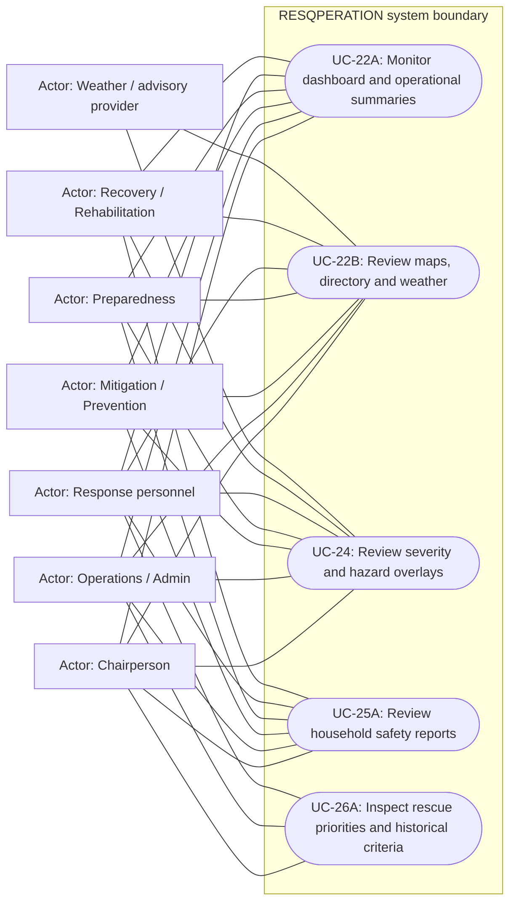

# Dashboard, maps, weather and priorities — use cases

Mermaid has no native UML use-case diagram. Actor boxes, oval goals and the system boundary form an explicitly UML-style view; association lines are not a process sequence. Supporting providers are external actors, not additional staff roles.

## Use cases and responsibilities

| ID | Goal | Primary actor / permitted baseline role | Result / important condition |
|---|---|---|---|
| UC-22A | Monitor dashboard and operational summaries | Chairperson, Operations / Admin, Mitigation / Prevention, Preparedness, Response personnel, Recovery / Rehabilitation | Charts/KPIs derive from selected operational database records.  |
| UC-22B | Review maps, directory and weather | Chairperson, Operations / Admin, Mitigation / Prevention, Preparedness, Response personnel, Recovery / Rehabilitation | Authorized geography/safety/weather data displayed.  |
| UC-24 | Review severity and hazard overlays | Chairperson, Operations / Admin, Mitigation / Prevention, Preparedness, Response personnel, Recovery / Rehabilitation | Stored severity/hazard evidence displayed. This use case does not claim an implemented arbitrary area-drawing or hazard-edit UI. |
| UC-25A | Review household safety reports | Chairperson, Operations / Admin, Mitigation / Prevention, Preparedness, Response personnel, Recovery / Rehabilitation | Household safety data shown within geographic scope.  |
| UC-26A | Inspect rescue priorities and historical criteria | Chairperson, Operations / Admin, Response personnel | Database-backed priorities and versioned evidence displayed.  |

[Raw Mermaid](06_monitoring_use_cases.mmd) | [Package index](../00_README.md) | [Current case catalog](../06_REFERENCE/01_current_use_case_catalog.md)
