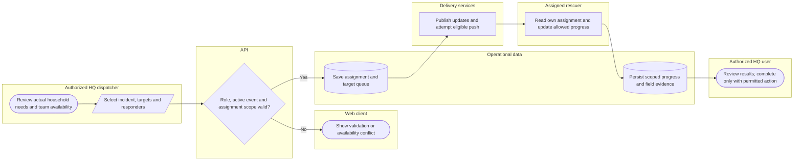

# Dispatch a scoped rescue assignment

HQ approval and mobile household-queue completion are different endpoints with different guards. Lanes identify responsibility; arrows identify control/handoff rather than database foreign keys.

## Use cases and responsibilities

| ID | Goal | Primary actor / permitted baseline role | Result / important condition |
|---|---|---|---|
| UC-15 | View own assigned incidents and households | Rescuer team leader, Rescuer team member | Only the authorized rescuer assignment/household scope is returned.  |
| UC-16 | Navigate and update assigned mission progress | Rescuer team leader, Rescuer team member | Permitted route, progress and foreground location updates recorded. Active-event, assignment ownership, household queue and valid transition rules apply. Mobile completion is not equivalent to the HQ approval endpoint. |
| UC-25B | Confirm a household status report | Chairperson, Operations / Admin, Response personnel | Authorized operational confirmation recorded.  |
| UC-26A | Inspect rescue priorities and historical criteria | Chairperson, Operations / Admin, Response personnel | Database-backed priorities and versioned evidence displayed.  |
| UC-26B | Dispatch a rescue team | Chairperson, Operations / Admin, Response personnel | Validated assignment targets and team/responder scope saved.  |
| UC-26C | Complete a dispatch through HQ approval | Chairperson, Operations / Admin | Permitted HQ completion recorded. HQ completion is an approve action, distinct from rescuer household-queue progress. |
| UC-27 | Monitor field reports and team progress | Chairperson, Operations / Admin, Response personnel | HQ operational progress/evidence displayed.  |

[Raw Mermaid](07_dispatch_swimlane.mmd) | [Package index](../00_README.md) | [Current case catalog](../06_REFERENCE/01_current_use_case_catalog.md)
