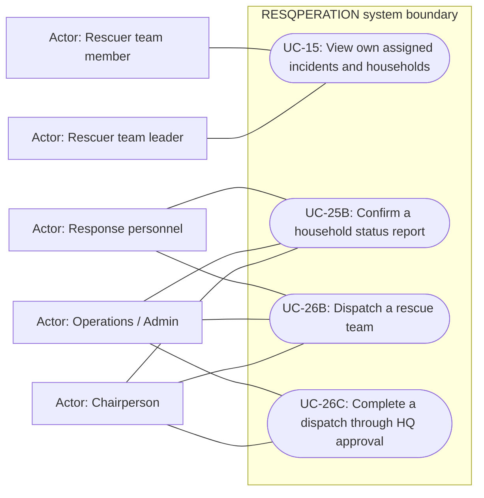

# Rescue dispatch and mission progress — use cases

Mermaid has no native UML use-case diagram. Actor boxes, oval goals and the system boundary form an explicitly UML-style view; association lines are not a process sequence. Supporting providers are external actors, not additional staff roles.

## Use cases and responsibilities

| ID | Goal | Primary actor / permitted baseline role | Result / important condition |
|---|---|---|---|
| UC-15 | View own assigned incidents and households | Rescuer team leader, Rescuer team member | Only the authorized rescuer assignment/household scope is returned.  |
| UC-25B | Confirm a household status report | Chairperson, Operations / Admin, Response personnel | Authorized operational confirmation recorded.  |
| UC-26B | Dispatch a rescue team | Chairperson, Operations / Admin, Response personnel | Validated assignment targets and team/responder scope saved.  |
| UC-26C | Complete a dispatch through HQ approval | Chairperson, Operations / Admin | Permitted HQ completion recorded. HQ completion is an approve action, distinct from rescuer household-queue progress. |

[Raw Mermaid](07_dispatch_use_cases.mmd) | [Package index](../00_README.md) | [Current case catalog](../06_REFERENCE/01_current_use_case_catalog.md)
