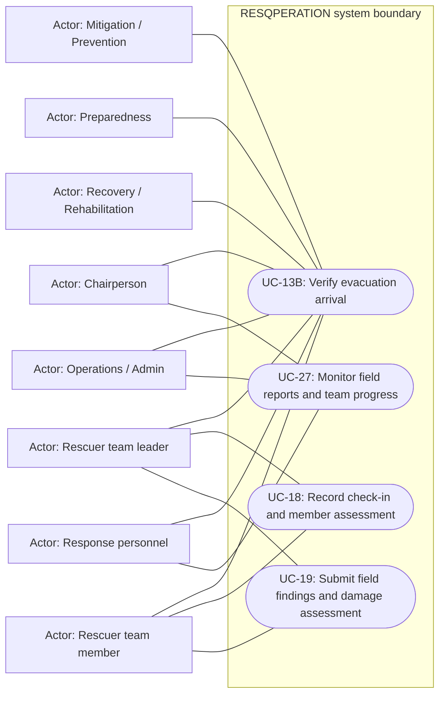

# Field assessment and evacuation evidence — use cases

Mermaid has no native UML use-case diagram. Actor boxes, oval goals and the system boundary form an explicitly UML-style view; association lines are not a process sequence. Supporting providers are external actors, not additional staff roles.

## Use cases and responsibilities

| ID | Goal | Primary actor / permitted baseline role | Result / important condition |
|---|---|---|---|
| UC-13B | Verify evacuation arrival | Chairperson, Operations / Admin, Mitigation / Prevention, Preparedness, Response personnel, Recovery / Rehabilitation, Rescuer team leader, Rescuer team member | Authorized verification/check-in updates shared evacuation evidence. Backend verifier access is supported; a dedicated scanner account role or complete staff scanning UI is not established by these routes. |
| UC-18 | Record check-in and member assessment | Rescuer team leader, Rescuer team member | Scoped field/check-in evidence recorded.  |
| UC-19 | Submit field findings and damage assessment | Rescuer team leader, Rescuer team member | Validated report header, member assessment and catalog damage choice stored. Actual database keys/labels, assignment/event scope and retry protections are used. |
| UC-27 | Monitor field reports and team progress | Chairperson, Operations / Admin, Response personnel | HQ operational progress/evidence displayed.  |

[Raw Mermaid](08_assessment_use_cases.mmd) | [Package index](../00_README.md) | [Current case catalog](../06_REFERENCE/01_current_use_case_catalog.md)
