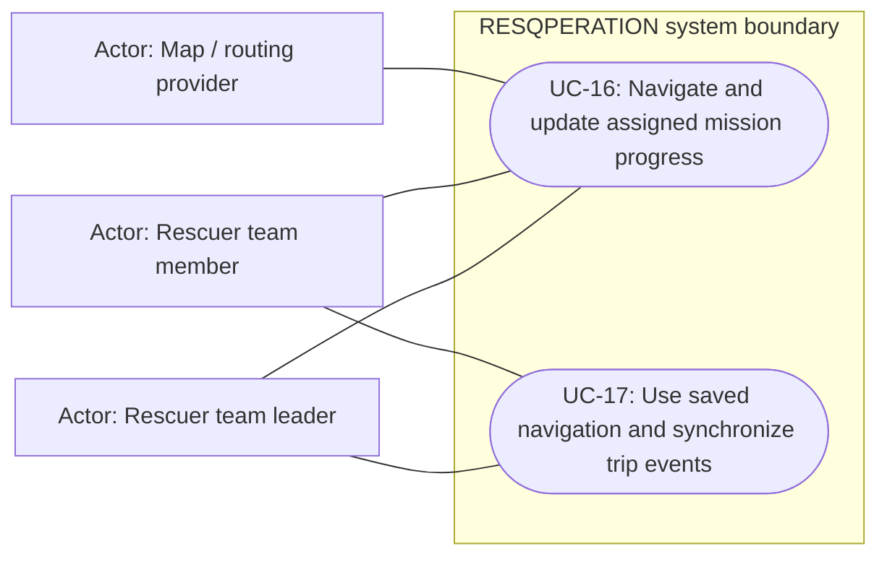

# Navigation and supported offline synchronization — use cases

Mermaid has no native UML use-case diagram. Actor boxes, oval goals and the system boundary form an explicitly UML-style view; association lines are not a process sequence. Supporting providers are external actors, not additional staff roles.

## Use cases and responsibilities

| ID | Goal | Primary actor / permitted baseline role | Result / important condition |
|---|---|---|---|
| UC-16 | Navigate and update assigned mission progress | Rescuer team leader, Rescuer team member | Permitted route, progress and foreground location updates recorded. Active-event, assignment ownership, household queue and valid transition rules apply. Mobile completion is not equivalent to the HQ approval endpoint. |
| UC-17 | Use saved navigation and synchronize trip events | Rescuer team leader, Rescuer team member | Supported local trip events receive server acknowledgments after reconnect. Conditional on native storage, valid cached route/pack and device binding. Never generalize this outbox to every mobile write. |

[Raw Mermaid](09_navigation_use_cases.mmd) | [Package index](../00_README.md) | [Current case catalog](../06_REFERENCE/01_current_use_case_catalog.md)
