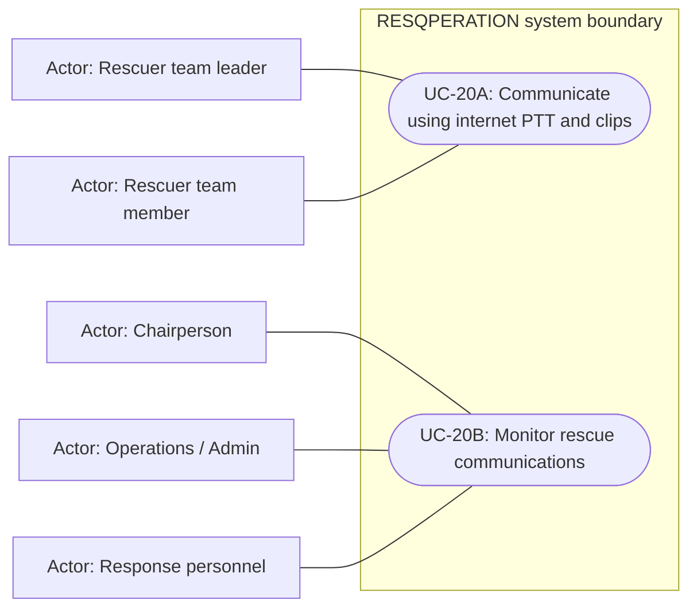

# Internet radio and audio evidence — use cases

Mermaid has no native UML use-case diagram. Actor boxes, oval goals and the system boundary form an explicitly UML-style view; association lines are not a process sequence. Supporting providers are external actors, not additional staff roles.

## Use cases and responsibilities

| ID | Goal | Primary actor / permitted baseline role | Result / important condition |
|---|---|---|---|
| UC-20A | Communicate using internet PTT and clips | Rescuer team leader, Rescuer team member | Internet radio activity and playable clip references recorded. Requires connectivity and microphone access. It is not offline hardware radio; audio files are outside MySQL. |
| UC-20B | Monitor rescue communications | Chairperson, Operations / Admin, Response personnel | Authorized HQ can review operational communication metadata.  |

[Raw Mermaid](10_radio_use_cases.mmd) | [Package index](../00_README.md) | [Current case catalog](../06_REFERENCE/01_current_use_case_catalog.md)
