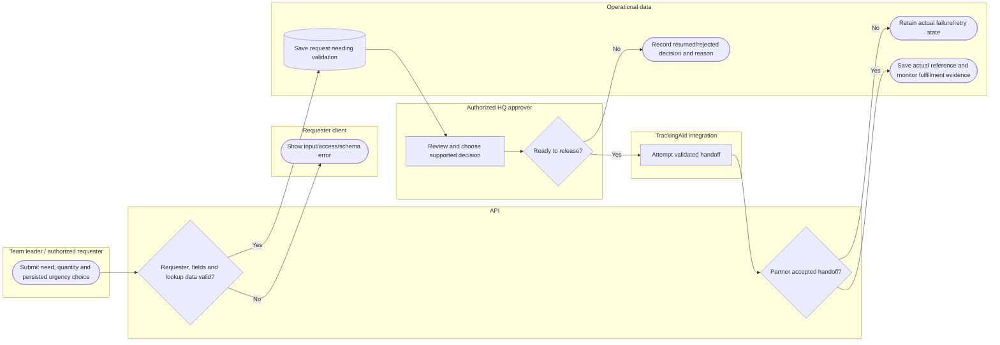

# Validate a request before partner handoff

Resource module visibility does not authorize approval; field submission is team-leader-only. Forwarding is not proof of delivery. Lanes identify responsibility; arrows identify control/handoff rather than database foreign keys.

## Use cases and responsibilities

| ID | Goal | Primary actor / permitted baseline role | Result / important condition |
|---|---|---|---|
| UC-21A | Submit a field logistics request | Rescuer team leader | Persisted request awaits HQ validation. Submission is team-leader-only. Base rescuer identity alone does not grant this POST action. |
| UC-21B | Track or cancel an eligible own request | Rescuer team leader, Rescuer team member | Own request state shown or an allowed cancellation recorded. Ownership and current state limit cancellation. |
| UC-31 | Submit an external resource request | Authorized request partner | Authenticated partner request enters the persisted workflow. Partner authentication/contract validation is separate from human sign-in. |
| UC-32A | Review and record resource requests | Chairperson, Operations / Admin, Response personnel, Recovery / Rehabilitation | Authorized workspace or request record returned.  |
| UC-32B | Validate, return or complete a resource request | Chairperson, Operations / Admin | Validation decision/history/status saved. Module visibility does not confer approval. Status labels come from actual lookup records. |
| UC-33 | Forward a validated request and monitor fulfillment | Chairperson, Operations / Admin | Partner handoff/reference and actual fulfillment evidence recorded. Partner connectivity/acknowledgment is conditional. Forwarded does not mean delivered. |

[Raw Mermaid](11_requests_swimlane.mmd) | [Package index](../00_README.md) | [Current case catalog](../06_REFERENCE/01_current_use_case_catalog.md)
