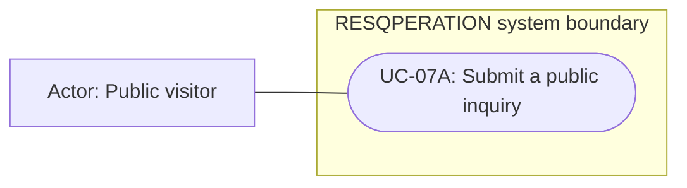

# Public visitor — permitted use cases

Mermaid has no native UML use-case diagram. Actor boxes, oval goals and the system boundary form an explicitly UML-style view; association lines are not a process sequence. This role view shows baseline capability, narrowed by configured role modules and record-level guards.

## Use cases and responsibilities

| ID | Goal | Primary actor / permitted baseline role | Result / important condition |
|---|---|---|---|
| UC-07A | Submit a public inquiry | Public visitor | Validated inquiry stored in landing_inquiries. Public submission does not grant staff review access. |

[Raw Mermaid](01_public.mmd) | [Package index](../00_README.md) | [Current case catalog](../06_REFERENCE/01_current_use_case_catalog.md)
