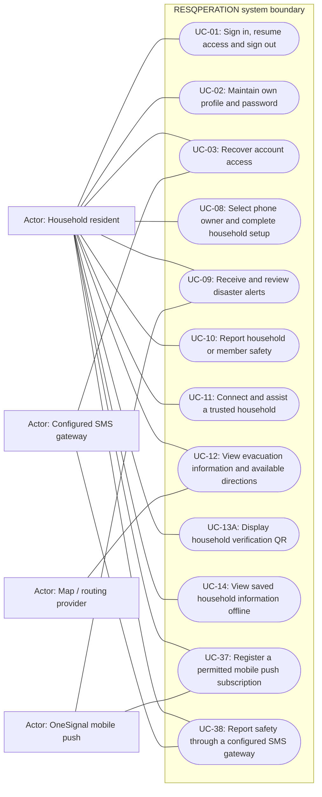

# Household resident — permitted use cases

Mermaid has no native UML use-case diagram. Actor boxes, oval goals and the system boundary form an explicitly UML-style view; association lines are not a process sequence. This role view shows baseline capability, narrowed by configured role modules and record-level guards.

## Use cases and responsibilities

| ID | Goal | Primary actor / permitted baseline role | Result / important condition |
|---|---|---|---|
| UC-01 | Sign in, resume access and sign out | Chairperson, Operations / Admin, Mitigation / Prevention, Preparedness, Response personnel, Recovery / Rehabilitation, Household resident, Rescuer team leader, Rescuer team member | An authenticated, role-scoped session or a clear rejection. Household owner selection and mobile device binding can restrict the session before operational actions. |
| UC-02 | Maintain own profile and password | Chairperson, Operations / Admin, Mitigation / Prevention, Preparedness, Response personnel, Recovery / Rehabilitation, Household resident, Rescuer team leader, Rescuer team member | Permitted personal fields or credentials updated. These are role-specific entry points, not permission for every actor to call every listed route. |
| UC-03 | Recover account access | Chairperson, Operations / Admin, Mitigation / Prevention, Preparedness, Response personnel, Recovery / Rehabilitation, Household resident, Rescuer team leader, Rescuer team member | Verified recovery resets credentials. Security-question recovery and household SMS recovery are different branches; configured contact data, expiry and throttles apply. |
| UC-08 | Select phone owner and complete household setup | Household resident | Current phone is linked to an authorized household member and setup/geotag. Pending-owner tokens cannot perform ordinary household actions. Existing registered Android/iOS platform is preserved. |
| UC-09 | Receive and review disaster alerts | Household resident, Rescuer team leader, Rescuer team member | App reads stored alerts; eligible devices can receive provider pushes. Notification permission, native build, subscription and network availability are required for push delivery. |
| UC-10 | Report household or member safety | Household resident | Authorized status/history records updated. Use the active event and actual configured database/broadcast status choices. |
| UC-11 | Connect and assist a trusted household | Household resident | A permitted trusted connection can report scoped member status. A household ID alone is insufficient: connection state and PIN/permission checks apply. |
| UC-12 | View evacuation information and available directions | Household resident | Available site/map information is displayed. Availability of directions depends on the implemented client, location/provider data and connectivity; do not infer a dedicated household route API. |
| UC-13A | Display household verification QR | Household resident | Household verification information displayed.  |
| UC-14 | View saved household information offline | Household resident | An available account-scoped cached overview can be shown. Current useMobileOverview/mobileSnapshot supports cached reading. This does not establish durable offline household status submission. |
| UC-37 | Register a permitted mobile push subscription | Household resident, Rescuer team leader, Rescuer team member | Real subscription/permission/identity saved on the active backend. Native SDK registration and consent required. Legacy mobile platforms are used for Android only after provider verification. |
| UC-38 | Report safety through a configured SMS gateway | Household resident | A verified sender can record supported event status. Gateway signature/timestamp, matching household contact, active event and supported keyword are required. |

[Raw Mermaid](02_household_resident.mmd) | [Package index](../00_README.md) | [Current case catalog](../06_REFERENCE/01_current_use_case_catalog.md)
