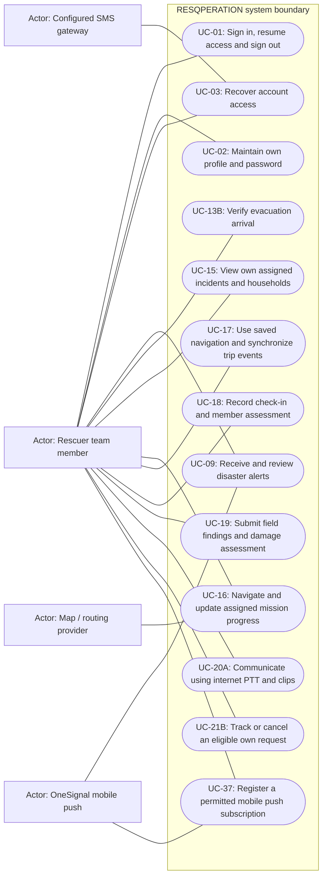

# Rescuer team member — permitted use cases

Mermaid has no native UML use-case diagram. Actor boxes, oval goals and the system boundary form an explicitly UML-style view; association lines are not a process sequence. This role view shows baseline capability, narrowed by configured role modules and record-level guards.

## Use cases and responsibilities

| ID | Goal | Primary actor / permitted baseline role | Result / important condition |
|---|---|---|---|
| UC-01 | Sign in, resume access and sign out | Chairperson, Operations / Admin, Mitigation / Prevention, Preparedness, Response personnel, Recovery / Rehabilitation, Household resident, Rescuer team leader, Rescuer team member | An authenticated, role-scoped session or a clear rejection. Household owner selection and mobile device binding can restrict the session before operational actions. |
| UC-02 | Maintain own profile and password | Chairperson, Operations / Admin, Mitigation / Prevention, Preparedness, Response personnel, Recovery / Rehabilitation, Household resident, Rescuer team leader, Rescuer team member | Permitted personal fields or credentials updated. These are role-specific entry points, not permission for every actor to call every listed route. |
| UC-03 | Recover account access | Chairperson, Operations / Admin, Mitigation / Prevention, Preparedness, Response personnel, Recovery / Rehabilitation, Household resident, Rescuer team leader, Rescuer team member | Verified recovery resets credentials. Security-question recovery and household SMS recovery are different branches; configured contact data, expiry and throttles apply. |
| UC-09 | Receive and review disaster alerts | Household resident, Rescuer team leader, Rescuer team member | App reads stored alerts; eligible devices can receive provider pushes. Notification permission, native build, subscription and network availability are required for push delivery. |
| UC-13B | Verify evacuation arrival | Chairperson, Operations / Admin, Mitigation / Prevention, Preparedness, Response personnel, Recovery / Rehabilitation, Rescuer team leader, Rescuer team member | Authorized verification/check-in updates shared evacuation evidence. Backend verifier access is supported; a dedicated scanner account role or complete staff scanning UI is not established by these routes. |
| UC-15 | View own assigned incidents and households | Rescuer team leader, Rescuer team member | Only the authorized rescuer assignment/household scope is returned.  |
| UC-16 | Navigate and update assigned mission progress | Rescuer team leader, Rescuer team member | Permitted route, progress and foreground location updates recorded. Active-event, assignment ownership, household queue and valid transition rules apply. Mobile completion is not equivalent to the HQ approval endpoint. |
| UC-17 | Use saved navigation and synchronize trip events | Rescuer team leader, Rescuer team member | Supported local trip events receive server acknowledgments after reconnect. Conditional on native storage, valid cached route/pack and device binding. Never generalize this outbox to every mobile write. |
| UC-18 | Record check-in and member assessment | Rescuer team leader, Rescuer team member | Scoped field/check-in evidence recorded.  |
| UC-19 | Submit field findings and damage assessment | Rescuer team leader, Rescuer team member | Validated report header, member assessment and catalog damage choice stored. Actual database keys/labels, assignment/event scope and retry protections are used. |
| UC-20A | Communicate using internet PTT and clips | Rescuer team leader, Rescuer team member | Internet radio activity and playable clip references recorded. Requires connectivity and microphone access. It is not offline hardware radio; audio files are outside MySQL. |
| UC-21B | Track or cancel an eligible own request | Rescuer team leader, Rescuer team member | Own request state shown or an allowed cancellation recorded. Ownership and current state limit cancellation. |
| UC-37 | Register a permitted mobile push subscription | Household resident, Rescuer team leader, Rescuer team member | Real subscription/permission/identity saved on the active backend. Native SDK registration and consent required. Legacy mobile platforms are used for Android only after provider verification. |

[Raw Mermaid](04_tm.mmd) | [Package index](../00_README.md) | [Current case catalog](../06_REFERENCE/01_current_use_case_catalog.md)
