# Chairperson — permitted use cases

Mermaid has no native UML use-case diagram. Actor boxes, oval goals and the system boundary form an explicitly UML-style view; association lines are not a process sequence. This role view shows baseline capability, narrowed by configured role modules and record-level guards.

```mermaid
flowchart LR
  %% UML-style use-case view in Mermaid flowchart notation; neutral lines are associations.
  actorbrowserPush["Actor: Browser Push service"]
  actorchair["Actor: Chairperson"]
  actorevaTrack["Actor: EvaTrack report service"]
  actoroneSignal["Actor: OneSignal mobile push"]
  actorsafeTrack["Actor: SafeTrack report service"]
  actorsmsGateway["Actor: Configured SMS gateway"]
  actortrackingAid["Actor: TrackingAid"]
  actorweatherProvider["Actor: Weather / advisory provider"]
  subgraph systemBoundary["RESQPERATION system boundary"]
    caseUC01(["UC-01: Sign in, resume access and sign out"])
    caseUC02(["UC-02: Maintain own profile and password"])
    caseUC03(["UC-03: Recover account access"])
    caseUC13B(["UC-13B: Verify evacuation arrival"])
    caseUC20B(["UC-20B: Monitor rescue communications"])
    caseUC22A(["UC-22A: Monitor dashboard and operational summaries"])
    caseUC22B(["UC-22B: Review maps, directory and weather"])
    caseUC23A(["UC-23A: Declare a disaster and publish alert instructions"])
    caseUC23B(["UC-23B: Review, update and close an active event"])
    caseUC24(["UC-24: Review severity and hazard overlays"])
    caseUC25A(["UC-25A: Review household safety reports"])
    caseUC25B(["UC-25B: Confirm a household status report"])
    caseUC26A(["UC-26A: Inspect rescue priorities and historical criteria"])
    caseUC26B(["UC-26B: Dispatch a rescue team"])
    caseUC26C(["UC-26C: Complete a dispatch through HQ approval"])
    caseUC27(["UC-27: Monitor field reports and team progress"])
    caseUC28(["UC-28: Prepare, save and export a situation report"])
    caseUC29(["UC-29: Export findings for manual escalation"])
    caseUC30(["UC-30: Browse, export and manage scoped archive evidence"])
    caseUC32A(["UC-32A: Review and record resource requests"])
    caseUC32B(["UC-32B: Validate, return or complete a resource request"])
    caseUC33(["UC-33: Forward a validated request and monitor fulfillment"])
    caseUC34B(["UC-34B: Decide report release and generate a signed file"])
    caseUC35(["UC-35: Request and review a partner report"])
    caseUC36(["UC-36: Export selected situation findings"])
    caseUC39(["UC-39: Review notifications and enable browser push"])
  end
  actorchair --- caseUC01
  actorchair --- caseUC02
  actorchair --- caseUC03
  actorsmsGateway --- caseUC03
  actorchair --- caseUC13B
  actorchair --- caseUC20B
  actorchair --- caseUC22A
  actorchair --- caseUC22B
  actorweatherProvider --- caseUC22B
  actorchair --- caseUC23A
  actoroneSignal --- caseUC23A
  actorsmsGateway --- caseUC23A
  actorchair --- caseUC23B
  actorchair --- caseUC24
  actorweatherProvider --- caseUC24
  actorchair --- caseUC25A
  actorchair --- caseUC25B
  actorchair --- caseUC26A
  actorchair --- caseUC26B
  actorchair --- caseUC26C
  actorchair --- caseUC27
  actorchair --- caseUC28
  actorchair --- caseUC29
  actorchair --- caseUC30
  actorchair --- caseUC32A
  actorchair --- caseUC32B
  actorchair --- caseUC33
  actortrackingAid --- caseUC33
  actorchair --- caseUC34B
  actorsafeTrack --- caseUC34B
  actorevaTrack --- caseUC34B
  actortrackingAid --- caseUC34B
  actorchair --- caseUC35
  actorsafeTrack --- caseUC35
  actorevaTrack --- caseUC35
  actortrackingAid --- caseUC35
  actorchair --- caseUC36
  actorchair --- caseUC39
  actorbrowserPush --- caseUC39
```

## Use cases and responsibilities

| ID | Goal | Primary actor / permitted baseline role | Result / important condition |
|---|---|---|---|
| UC-01 | Sign in, resume access and sign out | Chairperson, Operations / Admin, Mitigation / Prevention, Preparedness, Response personnel, Recovery / Rehabilitation, Household resident, Rescuer team leader, Rescuer team member | An authenticated, role-scoped session or a clear rejection. Household owner selection and mobile device binding can restrict the session before operational actions. |
| UC-02 | Maintain own profile and password | Chairperson, Operations / Admin, Mitigation / Prevention, Preparedness, Response personnel, Recovery / Rehabilitation, Household resident, Rescuer team leader, Rescuer team member | Permitted personal fields or credentials updated. These are role-specific entry points, not permission for every actor to call every listed route. |
| UC-03 | Recover account access | Chairperson, Operations / Admin, Mitigation / Prevention, Preparedness, Response personnel, Recovery / Rehabilitation, Household resident, Rescuer team leader, Rescuer team member | Verified recovery resets credentials. Security-question recovery and household SMS recovery are different branches; configured contact data, expiry and throttles apply. |
| UC-13B | Verify evacuation arrival | Chairperson, Operations / Admin, Mitigation / Prevention, Preparedness, Response personnel, Recovery / Rehabilitation, Rescuer team leader, Rescuer team member | Authorized verification/check-in updates shared evacuation evidence. Backend verifier access is supported; a dedicated scanner account role or complete staff scanning UI is not established by these routes. |
| UC-20B | Monitor rescue communications | Chairperson, Operations / Admin, Response personnel | Authorized HQ can review operational communication metadata.  |
| UC-22A | Monitor dashboard and operational summaries | Chairperson, Operations / Admin, Mitigation / Prevention, Preparedness, Response personnel, Recovery / Rehabilitation | Charts/KPIs derive from selected operational database records.  |
| UC-22B | Review maps, directory and weather | Chairperson, Operations / Admin, Mitigation / Prevention, Preparedness, Response personnel, Recovery / Rehabilitation | Authorized geography/safety/weather data displayed.  |
| UC-23A | Declare a disaster and publish alert instructions | Chairperson, Operations / Admin | Event/alert saved; actual provider delivery state recorded. Publishing is Chairperson/Operations-Admin under current policy. A saved alert can still have no recipients or provider failure; only accepted messages have provider IDs. |
| UC-23B | Review, update and close an active event | Chairperson, Operations / Admin, Response personnel | Permitted event lifecycle change recorded. Close/review/update follow their actual route actions; do not assume all publication permissions are identical. |
| UC-24 | Review severity and hazard overlays | Chairperson, Operations / Admin, Mitigation / Prevention, Preparedness, Response personnel, Recovery / Rehabilitation | Stored severity/hazard evidence displayed. This use case does not claim an implemented arbitrary area-drawing or hazard-edit UI. |
| UC-25A | Review household safety reports | Chairperson, Operations / Admin, Mitigation / Prevention, Preparedness, Response personnel, Recovery / Rehabilitation | Household safety data shown within geographic scope.  |
| UC-25B | Confirm a household status report | Chairperson, Operations / Admin, Response personnel | Authorized operational confirmation recorded.  |
| UC-26A | Inspect rescue priorities and historical criteria | Chairperson, Operations / Admin, Response personnel | Database-backed priorities and versioned evidence displayed.  |
| UC-26B | Dispatch a rescue team | Chairperson, Operations / Admin, Response personnel | Validated assignment targets and team/responder scope saved.  |
| UC-26C | Complete a dispatch through HQ approval | Chairperson, Operations / Admin | Permitted HQ completion recorded. HQ completion is an approve action, distinct from rescuer household-queue progress. |
| UC-27 | Monitor field reports and team progress | Chairperson, Operations / Admin, Response personnel | HQ operational progress/evidence displayed.  |
| UC-28 | Prepare, save and export a situation report | Chairperson, Operations / Admin, Mitigation / Prevention, Preparedness, Response personnel, Recovery / Rehabilitation | Report created/exported from recorded data and operator inputs.  |
| UC-29 | Export findings for manual escalation | Chairperson, Operations / Admin, Mitigation / Prevention, Preparedness, Response personnel, Recovery / Rehabilitation | Exported document available for manual handoff. File export does not establish automatic transmission to every higher-level authority. |
| UC-30 | Browse, export and manage scoped archive evidence | Chairperson, Operations / Admin, Mitigation / Prevention, Preparedness, Response personnel, Recovery / Rehabilitation | Authorized archive evidence reviewed or managed. Use record IDs, source validation and recording availability. Destructive actions still require their own validation/confirmation. |
| UC-32A | Review and record resource requests | Chairperson, Operations / Admin, Response personnel, Recovery / Rehabilitation | Authorized workspace or request record returned.  |
| UC-32B | Validate, return or complete a resource request | Chairperson, Operations / Admin | Validation decision/history/status saved. Module visibility does not confer approval. Status labels come from actual lookup records. |
| UC-33 | Forward a validated request and monitor fulfillment | Chairperson, Operations / Admin | Partner handoff/reference and actual fulfillment evidence recorded. Partner connectivity/acknowledgment is conditional. Forwarded does not mean delivered. |
| UC-34B | Decide report release and generate a signed file | Chairperson, Operations / Admin, Mitigation / Prevention, Preparedness, Response personnel, Recovery / Rehabilitation | Accepted snapshot/file or rejection reason persisted. This is governed by the reports module, not automatically the resource-request approve permission. |
| UC-35 | Request and review a partner report | Chairperson, Operations / Admin, Mitigation / Prevention, Preparedness, Response personnel, Recovery / Rehabilitation | Available partner report returned or explicit provider error.  |
| UC-36 | Export selected situation findings | Chairperson, Operations / Admin, Mitigation / Prevention, Preparedness, Response personnel, Recovery / Rehabilitation | Permitted sections exported in the implemented format.  |
| UC-39 | Review notifications and enable browser push | Chairperson, Operations / Admin, Mitigation / Prevention, Preparedness, Response personnel, Recovery / Rehabilitation | Authorized web notifications or browser subscription updated. Browser push uses VAPID/service-worker configuration and HTTPS requirements; it is separate from mobile OneSignal. |

[Raw Mermaid](05_chair.mmd) | [Package index](../00_README.md) | [Current case catalog](../06_REFERENCE/01_current_use_case_catalog.md)
