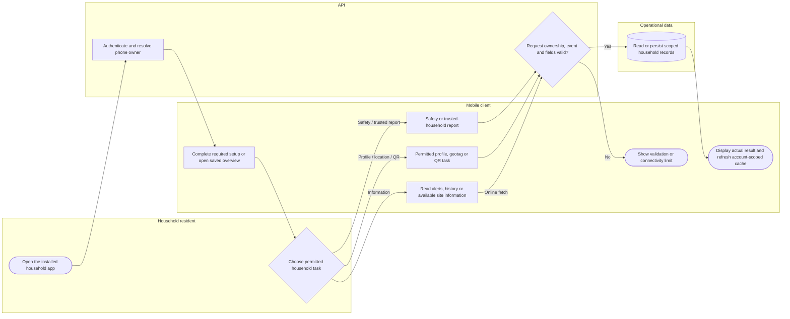

# Household mobile subsystem

Valid cached reading may remain available offline; operational writes still need their implemented online validation. Push registration/consent is a separate prerequisite for provider alerts. Lanes identify responsibility; arrows identify control/handoff rather than database foreign keys.

## Use cases and responsibilities

| ID | Goal | Primary actor / permitted baseline role | Result / important condition |
|---|---|---|---|
| UC-08 | Select phone owner and complete household setup | Household resident | Current phone is linked to an authorized household member and setup/geotag. Pending-owner tokens cannot perform ordinary household actions. Existing registered Android/iOS platform is preserved. |
| UC-09 | Receive and review disaster alerts | Household resident, Rescuer team leader, Rescuer team member | App reads stored alerts; eligible devices can receive provider pushes. Notification permission, native build, subscription and network availability are required for push delivery. |
| UC-10 | Report household or member safety | Household resident | Authorized status/history records updated. Use the active event and actual configured database/broadcast status choices. |
| UC-11 | Connect and assist a trusted household | Household resident | A permitted trusted connection can report scoped member status. A household ID alone is insufficient: connection state and PIN/permission checks apply. |
| UC-12 | View evacuation information and available directions | Household resident | Available site/map information is displayed. Availability of directions depends on the implemented client, location/provider data and connectivity; do not infer a dedicated household route API. |
| UC-13A | Display household verification QR | Household resident | Household verification information displayed.  |
| UC-14 | View saved household information offline | Household resident | An available account-scoped cached overview can be shown. Current useMobileOverview/mobileSnapshot supports cached reading. This does not establish durable offline household status submission. |
| UC-37 | Register a permitted mobile push subscription | Household resident, Rescuer team leader, Rescuer team member | Real subscription/permission/identity saved on the active backend. Native SDK registration and consent required. Legacy mobile platforms are used for Android only after provider verification. |

[Raw Mermaid](01_household_mobile.mmd) | [Package index](../00_README.md) | [Current case catalog](../06_REFERENCE/01_current_use_case_catalog.md)
