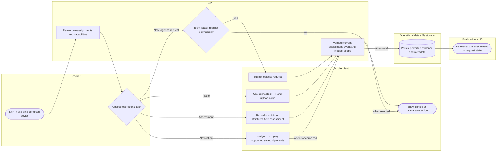

# Rescuer mobile subsystem

All mobile tasks keep assignment/identity scope. Offline navigation does not make internet PTT or every other mutation work offline. Lanes identify responsibility; arrows identify control/handoff rather than database foreign keys.

## Use cases and responsibilities

| ID | Goal | Primary actor / permitted baseline role | Result / important condition |
|---|---|---|---|
| UC-15 | View own assigned incidents and households | Rescuer team leader, Rescuer team member | Only the authorized rescuer assignment/household scope is returned.  |
| UC-16 | Navigate and update assigned mission progress | Rescuer team leader, Rescuer team member | Permitted route, progress and foreground location updates recorded. Active-event, assignment ownership, household queue and valid transition rules apply. Mobile completion is not equivalent to the HQ approval endpoint. |
| UC-17 | Use saved navigation and synchronize trip events | Rescuer team leader, Rescuer team member | Supported local trip events receive server acknowledgments after reconnect. Conditional on native storage, valid cached route/pack and device binding. Never generalize this outbox to every mobile write. |
| UC-18 | Record check-in and member assessment | Rescuer team leader, Rescuer team member | Scoped field/check-in evidence recorded.  |
| UC-19 | Submit field findings and damage assessment | Rescuer team leader, Rescuer team member | Validated report header, member assessment and catalog damage choice stored. Actual database keys/labels, assignment/event scope and retry protections are used. |
| UC-20A | Communicate using internet PTT and clips | Rescuer team leader, Rescuer team member | Internet radio activity and playable clip references recorded. Requires connectivity and microphone access. It is not offline hardware radio; audio files are outside MySQL. |
| UC-21A | Submit a field logistics request | Rescuer team leader | Persisted request awaits HQ validation. Submission is team-leader-only. Base rescuer identity alone does not grant this POST action. |
| UC-21B | Track or cancel an eligible own request | Rescuer team leader, Rescuer team member | Own request state shown or an allowed cancellation recorded. Ownership and current state limit cancellation. |
| UC-37 | Register a permitted mobile push subscription | Household resident, Rescuer team leader, Rescuer team member | Real subscription/permission/identity saved on the active backend. Native SDK registration and consent required. Legacy mobile platforms are used for Android only after provider verification. |

[Raw Mermaid](02_rescuer_mobile.mmd) | [Package index](../00_README.md) | [Current case catalog](../06_REFERENCE/01_current_use_case_catalog.md)
