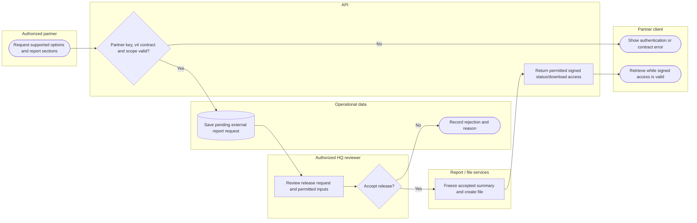

# Partner report exchange subsystem

This subsystem view focuses on incoming report release. Outgoing partner retrieval is a distinct configured API flow; resource handoff is detailed in its own business swimlane. Lanes identify responsibility; arrows identify control/handoff rather than database foreign keys.

## Use cases and responsibilities

| ID | Goal | Primary actor / permitted baseline role | Result / important condition |
|---|---|---|---|
| UC-34A | Request a Resqperation report | SafeTrack report service, EvaTrack report service, TrackingAid | Valid partner contract creates a pending report request. Current ReportExchangeController requires contract v4.0 with permitted event, sitio, sections and format. |
| UC-34B | Decide report release and generate a signed file | Chairperson, Operations / Admin, Mitigation / Prevention, Preparedness, Response personnel, Recovery / Rehabilitation | Accepted snapshot/file or rejection reason persisted. This is governed by the reports module, not automatically the resource-request approve permission. |
| UC-35 | Request and review a partner report | Chairperson, Operations / Admin, Mitigation / Prevention, Preparedness, Response personnel, Recovery / Rehabilitation | Available partner report returned or explicit provider error.  |

[Raw Mermaid](04_partner_report_exchange.mmd) | [Package index](../00_README.md) | [Current case catalog](../06_REFERENCE/01_current_use_case_catalog.md)
