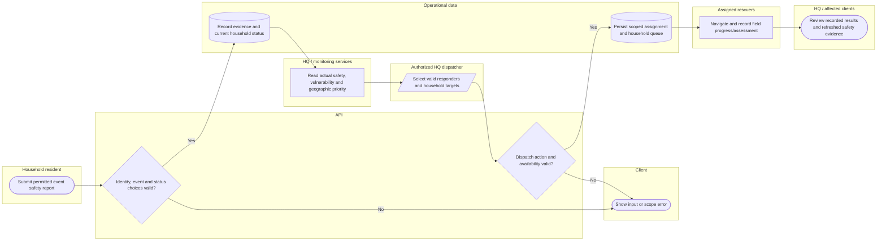

# Household safety evidence to rescue response

A safety report informs prioritization; it does not automatically dispatch a team or bypass the authorized dispatcher. Lanes identify responsibility; arrows identify control/handoff rather than database foreign keys.

## Use cases and responsibilities

| ID | Goal | Primary actor / permitted baseline role | Result / important condition |
|---|---|---|---|
| UC-10 | Report household or member safety | Household resident | Authorized status/history records updated. Use the active event and actual configured database/broadcast status choices. |
| UC-15 | View own assigned incidents and households | Rescuer team leader, Rescuer team member | Only the authorized rescuer assignment/household scope is returned.  |
| UC-16 | Navigate and update assigned mission progress | Rescuer team leader, Rescuer team member | Permitted route, progress and foreground location updates recorded. Active-event, assignment ownership, household queue and valid transition rules apply. Mobile completion is not equivalent to the HQ approval endpoint. |
| UC-19 | Submit field findings and damage assessment | Rescuer team leader, Rescuer team member | Validated report header, member assessment and catalog damage choice stored. Actual database keys/labels, assignment/event scope and retry protections are used. |
| UC-25A | Review household safety reports | Chairperson, Operations / Admin, Mitigation / Prevention, Preparedness, Response personnel, Recovery / Rehabilitation | Household safety data shown within geographic scope.  |
| UC-26A | Inspect rescue priorities and historical criteria | Chairperson, Operations / Admin, Response personnel | Database-backed priorities and versioned evidence displayed.  |
| UC-26B | Dispatch a rescue team | Chairperson, Operations / Admin, Response personnel | Validated assignment targets and team/responder scope saved.  |
| UC-27 | Monitor field reports and team progress | Chairperson, Operations / Admin, Response personnel | HQ operational progress/evidence displayed.  |

[Raw Mermaid](01_report_to_dispatch.mmd) | [Package index](../00_README.md) | [Current case catalog](../06_REFERENCE/01_current_use_case_catalog.md)
