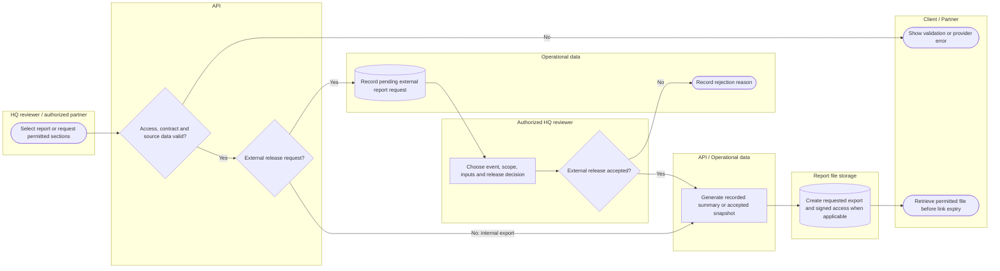

# Prepare or release a scoped report

Internal exports and external release are related but distinct branches. Manual escalation is not an automatic district handoff. Lanes identify responsibility; arrows identify control/handoff rather than database foreign keys.

## Use cases and responsibilities

| ID | Goal | Primary actor / permitted baseline role | Result / important condition |
|---|---|---|---|
| UC-28 | Prepare, save and export a situation report | Chairperson, Operations / Admin, Mitigation / Prevention, Preparedness, Response personnel, Recovery / Rehabilitation | Report created/exported from recorded data and operator inputs.  |
| UC-29 | Export findings for manual escalation | Chairperson, Operations / Admin, Mitigation / Prevention, Preparedness, Response personnel, Recovery / Rehabilitation | Exported document available for manual handoff. File export does not establish automatic transmission to every higher-level authority. |
| UC-30 | Browse, export and manage scoped archive evidence | Chairperson, Operations / Admin, Mitigation / Prevention, Preparedness, Response personnel, Recovery / Rehabilitation | Authorized archive evidence reviewed or managed. Use record IDs, source validation and recording availability. Destructive actions still require their own validation/confirmation. |
| UC-34A | Request a Resqperation report | SafeTrack report service, EvaTrack report service, TrackingAid | Valid partner contract creates a pending report request. Current ReportExchangeController requires contract v4.0 with permitted event, sitio, sections and format. |
| UC-34B | Decide report release and generate a signed file | Chairperson, Operations / Admin, Mitigation / Prevention, Preparedness, Response personnel, Recovery / Rehabilitation | Accepted snapshot/file or rejection reason persisted. This is governed by the reports module, not automatically the resource-request approve permission. |
| UC-35 | Request and review a partner report | Chairperson, Operations / Admin, Mitigation / Prevention, Preparedness, Response personnel, Recovery / Rehabilitation | Available partner report returned or explicit provider error.  |
| UC-36 | Export selected situation findings | Chairperson, Operations / Admin, Mitigation / Prevention, Preparedness, Response personnel, Recovery / Rehabilitation | Permitted sections exported in the implemented format.  |

[Raw Mermaid](06_report_release_and_exports.mmd) | [Package index](../00_README.md) | [Current case catalog](../06_REFERENCE/01_current_use_case_catalog.md)
