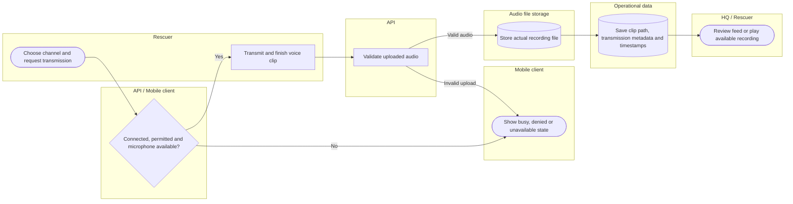

# Record and review internet PTT audio evidence

Audio binaries are not stored in MySQL. Playback must reflect file availability. Lanes identify responsibility; arrows identify control/handoff rather than database foreign keys.

## Use cases and responsibilities

| ID | Goal | Primary actor / permitted baseline role | Result / important condition |
|---|---|---|---|
| UC-20A | Communicate using internet PTT and clips | Rescuer team leader, Rescuer team member | Internet radio activity and playable clip references recorded. Requires connectivity and microphone access. It is not offline hardware radio; audio files are outside MySQL. |
| UC-20B | Monitor rescue communications | Chairperson, Operations / Admin, Response personnel | Authorized HQ can review operational communication metadata.  |
| UC-30 | Browse, export and manage scoped archive evidence | Chairperson, Operations / Admin, Mitigation / Prevention, Preparedness, Response personnel, Recovery / Rehabilitation | Authorized archive evidence reviewed or managed. Use record IDs, source validation and recording availability. Destructive actions still require their own validation/confirmation. |

[Raw Mermaid](08_radio_audio_evidence.mmd) | [Package index](../00_README.md) | [Current case catalog](../06_REFERENCE/01_current_use_case_catalog.md)
