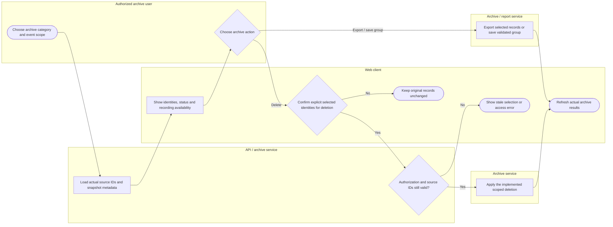

# Identify, review, export or delete archive evidence

Saved-group snapshots, source records and recording files have different lifecycles. File playback is available only when the actual retained recording exists; the diagram does not assert that every deletion removes every related file. Lanes identify responsibility; arrows identify control/handoff rather than database foreign keys.

## Use cases and responsibilities

| ID | Goal | Primary actor / permitted baseline role | Result / important condition |
|---|---|---|---|
| UC-20B | Monitor rescue communications | Chairperson, Operations / Admin, Response personnel | Authorized HQ can review operational communication metadata.  |
| UC-30 | Browse, export and manage scoped archive evidence | Chairperson, Operations / Admin, Mitigation / Prevention, Preparedness, Response personnel, Recovery / Rehabilitation | Authorized archive evidence reviewed or managed. Use record IDs, source validation and recording availability. Destructive actions still require their own validation/confirmation. |

[Raw Mermaid](09_archive_identification_and_actions.mmd) | [Package index](../00_README.md) | [Current case catalog](../06_REFERENCE/01_current_use_case_catalog.md)
