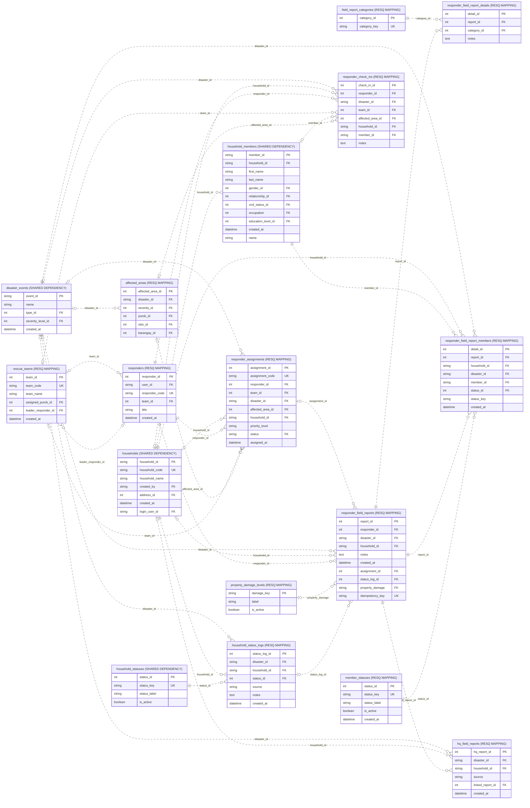

# Field reports and damage assessment

Source: shared_db, 2026-10-31T13:37:40+08:00. 17 objects; 34 enforced relationships; 108 displayed columns.

Categories attach to category detail counts; property damage uses the persisted damage catalog.

Presentation view: keys and selected business fields only. Context tables can have additional relationships outside this module; use the unified ERD for those.

[Raw Mermaid](04_field_assessment.mmd) | [Diagram index](../00_README.md)
