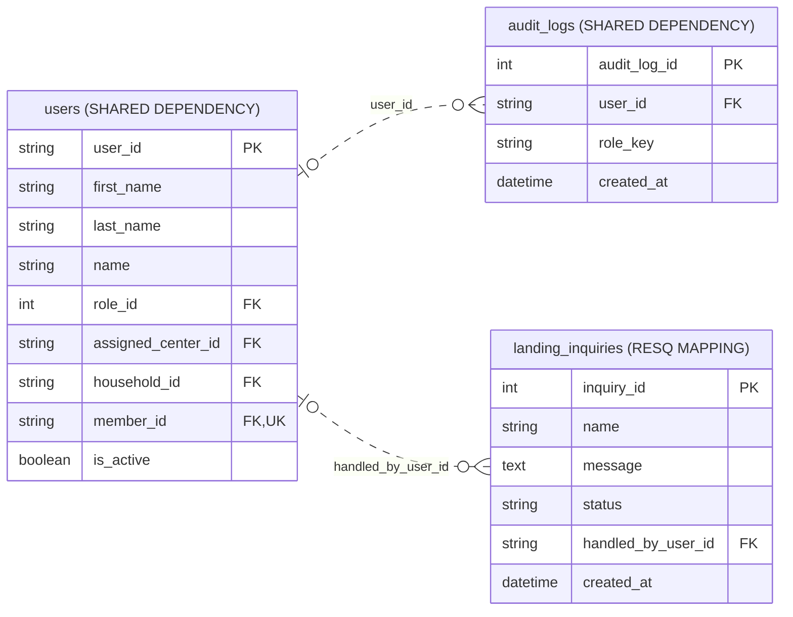

# Public inquiries and staff handling

Source: shared_db, 2026-10-31T13:37:40+08:00. 3 objects; 2 enforced relationships; 19 displayed columns.

The implemented table is landing_inquiries. The separate unconfirmed inquiries table is excluded.

Presentation view: keys and selected business fields only. Context tables can have additional relationships outside this module; use the unified ERD for those.

[Raw Mermaid](08_public_inquiries.mmd) | [Diagram index](../00_README.md)
