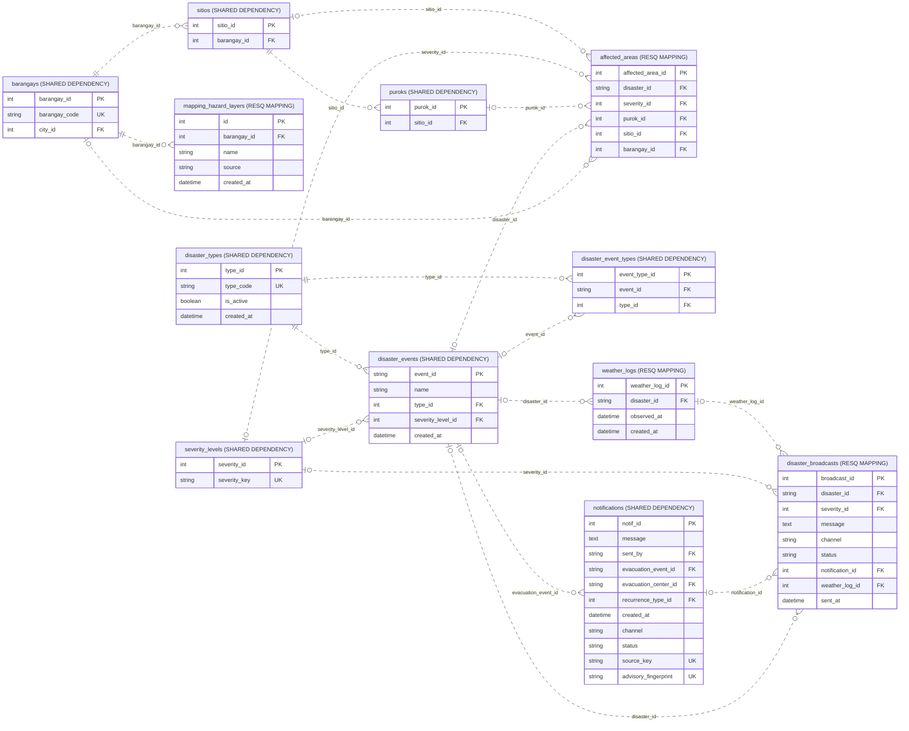

# Disaster events, hazards and weather

Source: shared_db, 2026-10-31T13:37:40+08:00. 12 objects; 18 enforced relationships; 56 displayed columns.

Includes the actual event/type junction used by broadcast workflows. External providers are data sources, not SQL tables.

Presentation view: keys and selected business fields only. Context tables can have additional relationships outside this module; use the unified ERD for those.

[Raw Mermaid](11_disasters_and_weather.mmd) | [Diagram index](../00_README.md)
