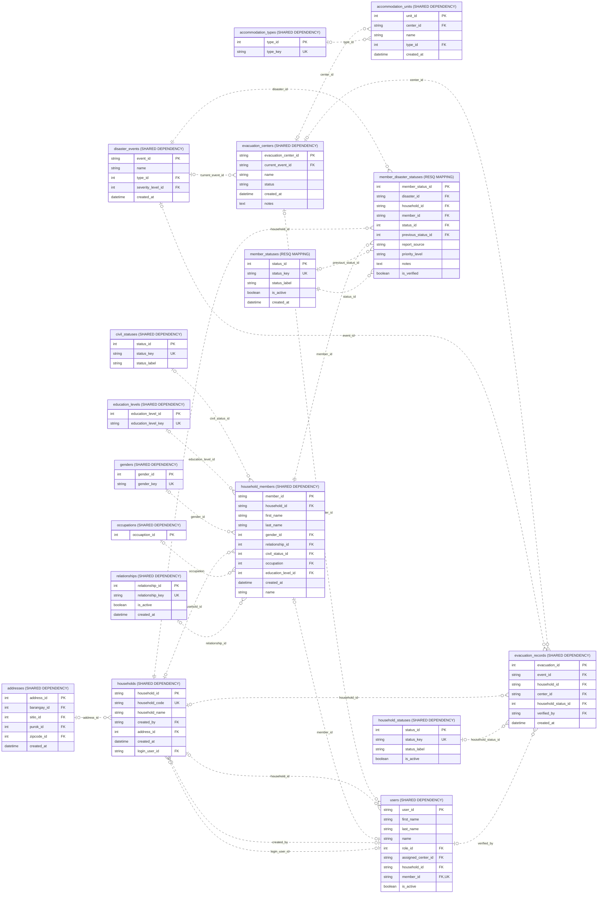

# Shared evacuation verification data

Source: shared_db, 2026-10-31T13:37:40+08:00. 17 objects; 25 enforced relationships; 89 displayed columns.

Used by check-in and situation reporting. Diagram inclusion does not transfer ownership or reconcile ambiguous shared records.

Presentation view: keys and selected business fields only. Context tables can have additional relationships outside this module; use the unified ERD for those.

[Raw Mermaid](12_shared_evacuation_data.mmd) | [Diagram index](../00_README.md)
