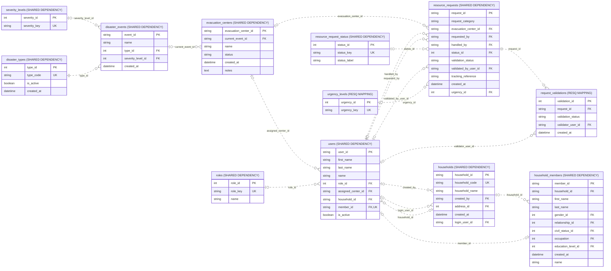

# Resource request validation and partner handoff data

Source: shared_db, 2026-10-31T13:37:40+08:00. 12 objects; 18 enforced relationships; 68 displayed columns.

Tracking/release fields are business values on real requests. Partner systems are not fabricated SQL entities.

Presentation view: keys and selected business fields only. Context tables can have additional relationships outside this module; use the unified ERD for those.

[Raw Mermaid](04_request_validation_handoff.mmd) | [Diagram index](../00_README.md)
