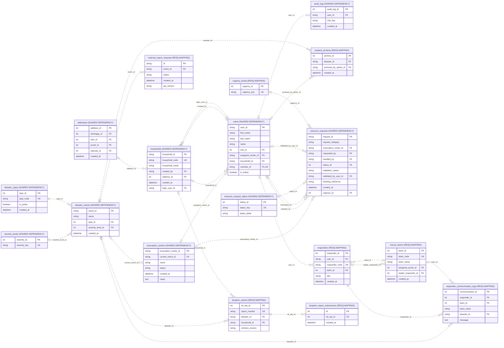

# Reporting, archives and radio evidence

Source: shared_db, 2026-10-31T13:37:40+08:00. 18 objects; 27 enforced relationships; 94 displayed columns.

Archive table-name/source-ID pairs and JSON file references are application-validated values, not one universal FK. Audio binaries stay outside MySQL.

Presentation view: keys and selected business fields only. Context tables can have additional relationships outside this module; use the unified ERD for those.

[Raw Mermaid](05_reporting_archives_recordings.mmd) | [Diagram index](../00_README.md)
