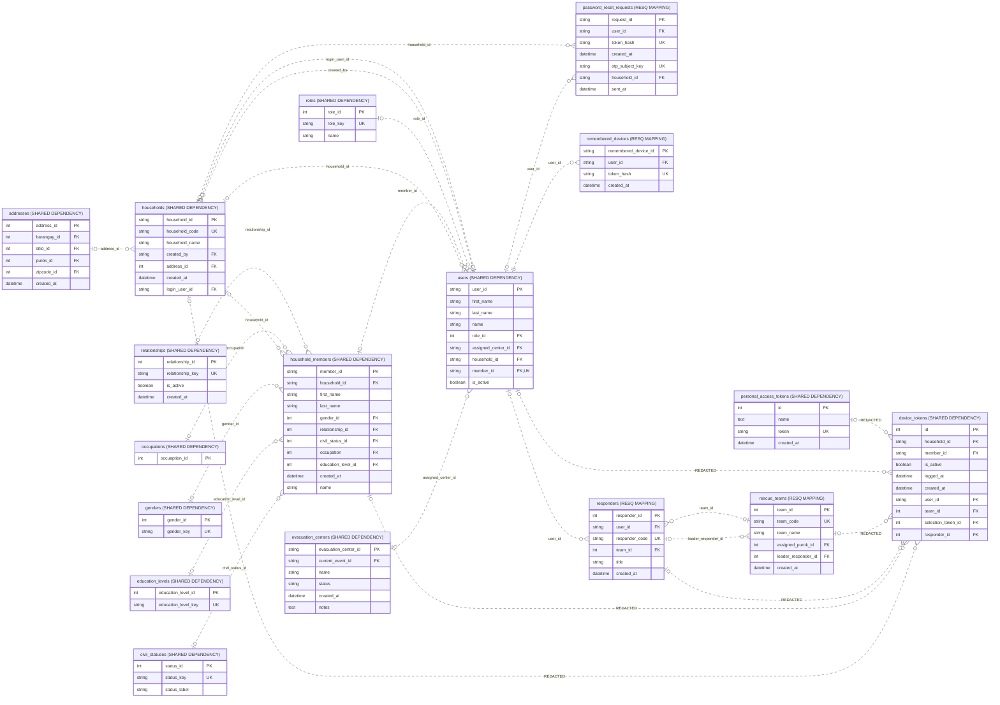

# Household login, device owner and recovery

Source: shared_db, 2026-10-31T13:37:40+08:00. 17 objects; 25 enforced relationships; 91 displayed columns.

Uses consolidated login_user_id, device owner/selection fields and SMS recovery. Retired duplicate access/OTP/device tables are not reintroduced.

Presentation view: keys and selected business fields only. Context tables can have additional relationships outside this module; use the unified ERD for those.

[Raw Mermaid](07_household_login_recovery.mmd) | [Diagram index](../00_README.md)
