# Views and retained legacy recovery objects

Source: shared_db, 2026-10-31T13:37:40+08:00. 4 objects; 0 enforced relationships; 105 displayed columns.

These objects have no ordinary FK lines. Views derive from base tables; recovery snapshots retain historical invalid references. Inclusion does not prove active CRUD or exclusive ownership.

All actual columns are shown; exact SQL types and composite unique groups are in the dictionary.

```mermaid
erDiagram
  direction LR
  %% Physical FKs only; views and independent stores receive no invented links.
  archiveOrphanHouseholdDisasters["_archive_orphan_household_disasters (LEGACY RECOVERY)"] {
    int household_disaster_id PK
    string household_id
    string disaster_id
    int initial_status_id
    int current_status_id
    string last_status_source
    text last_status_notes
    string last_reported_by_user_id
    int last_responder_id
    int last_device_token_id
    decimal last_latitude
    decimal last_longitude
    int last_battery_level
    datetime last_reported_at
    string priority_level
    boolean needs_dispatch
    datetime updated_at
    datetime created_at
  }
  archiveOrphanHouseholdStatusLogs["_archive_orphan_household_status_logs (LEGACY RECOVERY)"] {
    int status_log_id PK
    string disaster_id
    string household_id
    int status_id
    string source
    string submitted_by_user_id
    int responder_id
    int device_token_id
    decimal latitude
    decimal longitude
    string location_label
    decimal location_accuracy_m
    int battery_level
    int signal_strength
    text notes
    datetime submitted_at
    string reviewed_by_user_id
    datetime reviewed_at
    datetime created_at
    datetime updated_at
  }
  vHouseholdStatusBoard["v_household_status_board (VIEW)"] {
    string disaster_id
    string household_id
    string household_code
    string household_name
    int household_status_id
    string household_status_label
    string household_status_color
    int total_members
    decimal unreported
    decimal accounted_safe
    decimal needs_rescue_count
    decimal missing_count
    decimal injured_count
    decimal deceased_count
    int worst_severity
    datetime last_reported_at
    decimal latitude
    decimal longitude
  }
  vMemberStatusMonitor["v_member_status_monitor (VIEW)"] {
    int member_status_id
    string disaster_id
    string event_name
    datetime event_started_at
    datetime event_ended_at
    int event_is_active
    string household_id
    string household_code
    string household_number
    string household_name
    string household_contact
    string member_id
    string member_name
    int age
    string gender
    string relationship_label
    boolean is_household_head
    boolean is_pwd
    boolean is_senior
    boolean is_pregnant
    string account_user_id
    string account_username
    string account_email
    int has_account
    int status_id
    string status_key
    string status_label
    string status_color
    int severity_rank
    boolean needs_rescue
    string priority_level
    string previous_status_label
    string report_source
    string reported_by_user_id
    string reported_by_member_id
    string reported_by_name
    decimal latitude
    decimal longitude
    string location_label
    decimal location_accuracy_m
    int battery_level
    int signal_strength
    string evacuation_center_id
    text notes
    boolean is_verified
    datetime verified_at
    datetime reported_at
    datetime updated_at
    int minutes_since_report
  }
```

[Raw Mermaid](01_views_and_legacy_objects.mmd) | [Diagram index](../00_README.md)
