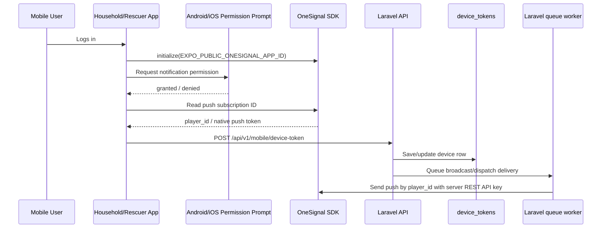

# RESQPERATION OneSignal Mobile Push Setup

Use this guide for RESQPERATION Android/iOS mobile push. The current OneSignal
term is **subscription ID**; older project code and OneSignal SDK versions may
call it a player ID. In this application it is stored as `device_tokens.player_id`.

This mobile push path is separate from browser Web Push. The web app uses
service-worker subscriptions and VAPID keys; it does not use a OneSignal mobile
subscription ID or the OneSignal REST API key.

## What Was Added In Frontend Mobile

- `react-native-onesignal`
- `onesignal-expo-plugin`
- `EXPO_PUBLIC_ONESIGNAL_APP_ID`
- OneSignal initialization in `frontend-mobile/utils/pushNotifications.ts`
- OneSignal permission prompt through the native system permission dialog
- OneSignal `player_id` / push subscription ID collection
- OneSignal fields included in the existing `/mobile/device-token` request

## Required OneSignal Dashboard Setup

1. Create or open the RESQPERATION app in OneSignal.
2. Copy the OneSignal App ID.
3. Configure the App ID as the mobile build variable
   `EXPO_PUBLIC_ONESIGNAL_APP_ID` or Expo config `extra.oneSignalAppId`. The
   backend `ONESIGNAL_APP_ID` must refer to the same OneSignal app.

```env
EXPO_PUBLIC_ONESIGNAL_APP_ID=<ONESIGNAL_APP_ID>
```

4. Configure the Android platform in OneSignal with the matching Firebase
   Cloud Messaging HTTP v1 service-account credentials.
5. Configure APNs credentials in OneSignal before enabling iOS delivery.
6. Configure the OneSignal REST API key only in Laravel's backend environment.

The App ID is public and is safe to include in a mobile build. The REST API key,
FCM service-account JSON, and APNs private key are secrets: never put them in
mobile variables, source code, this document, or a committed `.env` file.

## Authentication Rule

The mobile app authenticates to the OneSignal SDK using only the public
OneSignal App ID.

Do not put the OneSignal REST API key in `frontend-mobile`.

The REST API key is server-side only. Laravel uses it through
`OneSignalNotificationService` when the backend sends broadcasts or dispatch
assignments to OneSignal. Putting the REST API key in the mobile app would
expose it to anyone who extracts the app.

For server-side REST requests, OneSignal uses this header format:

```http
Authorization: Key YOUR_ONESIGNAL_API_KEY
```

That key belongs in Laravel `.env`, not in `frontend-mobile/.env`.

```env
ONESIGNAL_APP_ID=<ONESIGNAL_APP_ID>
ONESIGNAL_API_KEY=<ONESIGNAL_REST_API_KEY>
# Optional; defaults to https://api.onesignal.com
ONESIGNAL_BASE_URL=https://api.onesignal.com
# Optional; defaults to 10000
ONESIGNAL_MAX_RECIPIENTS=10000
```

Use the backend's local `.env` or deployment secret manager. After environment
changes, run `php artisan config:clear` and restart long-running workers.

## Development Build Required

OneSignal is a native SDK. Expo Go can run the mobile app by QR code for normal
screen/API testing, but Expo Go cannot generate a real OneSignal Player ID.

If only the location permission appears after login, the app is most likely
running in Expo Go or in an old build made before OneSignal was added. Install a
fresh RESQPERATION development build, then open that installed app instead of
Expo Go.

For normal phone QR testing:

```bash
cd frontend-mobile
npm start
```

Scan the QR code with Expo Go.

For real OneSignal push-token testing, install a development build on the actual
phone once, then start Metro in dev-client mode:

```bash
cd frontend-mobile
npm run build:dev:android
npm run start:dev
```

Open the QR with the installed RESQPERATION development app. No emulator is
required.

If EAS reports that build credits are already used, a new cloud APK will not be
created. Use one of these instead:

1. Install the latest finished Android development APK from EAS:

```text
https://expo.dev/artifacts/eas/22yUVpAXJ9QmuOdlZNS5sPJuqfSqk2QgsYr9tu4FX80.apk
```

After installing the APK on the physical phone, run:

```bash
npm run start:dev
```

If the installed app says `failed to connect to /192.168... port 8082`, the
phone cannot reach the laptop Metro server through LAN. Start Metro through a
tunnel instead:

```bash
npm run start:dev:tunnel
```

Use the QR or URL shown by the tunnel command inside the installed development
app. Tunnel mode is slower but avoids Wi-Fi isolation and Windows Firewall
blocking.

Do not use `expo run:android` for OneSignal testing in this project workflow.
That command can open an emulator/device selector. Use the installed APK and
`npm run start:dev` only.

The `npm run start:dev` QR is not an Expo Go QR. It is a development-client
deep link. If the normal phone camera says the QR has no usable data, open the
installed RESQPERATION development app and manually enter the Metro URL printed
after `url=`. For example, if the terminal prints:

```text
exp+frontend-mobile://expo-development-client/?url=http%3A%2F%2F192.168.112.130%3A8082
```

enter this URL inside the installed development app:

```text
http://192.168.112.130:8082
```

If Metro is stale or the app does not refresh, restart with:

```bash
npm run start:dev:clear
```

OneSignal subscriptions appear in the dashboard only after the installed app
opens, the mobile user logs in, and the Android/iOS notification permission is
accepted.

## How The Mobile Flow Works



After a successful mobile login, the app requests notification permission and
starts registration. A household account that must first select the device
owner registers after that selection. Registration is asynchronous; authenticated
household/rescuer screens retry it, and the app refreshes the database record
when the OneSignal subscription changes or the app resumes. `player_id` may be
unavailable until the native SDK has created a subscription and permission is
granted.

## Payload Sent By The Mobile App

The frontend now sends:

```json
{
  "device_uuid": "rescuer-...",
  "device_name": "Rescuer mobile",
  "platform": "android",
  "player_id": "onesignal-subscription-id",
  "push_token": "REDACTED",
  "push_provider": "onesignal",
  "one_signal_user_id": "onesignal-user-id",
  "battery_level": 88,
  "notification_permission_status": "granted"
}
```

## Backend Storage Rule

`POST /api/v1/mobile/device-token` requires the signed-in household or rescuer
account's Sanctum token. Laravel assigns `household_id`, `user_id`, and role
from that authenticated account; the client cannot choose a different
household. `device_uuid` identifies one app installation, so separate phones
have separate rows and a changed OneSignal subscription updates the matching
row.

The current `device_tokens` schema stores the OneSignal subscription ID in
`player_id`, together with `device_uuid`, `household_id`, `user_id`, `member_id`,
`platform`, `app_role`, `push_provider`, notification permission and device
activity fields. `player_id` is the OneSignal subscription ID, not the native
FCM/APNs token. The API accepts `push_token` and `one_signal_user_id` from the
mobile client, but these columns are not present in the current production
`device_tokens` schema, so those optional values are not persisted there.
RESQPERATION does not use Expo push tokens for this delivery path.

Rows can exist before a usable OneSignal subscription is available (for example
when the device first saves its location). An unavailable marker or null is not
a deliverable subscription. A real subscription is created by the native SDK;
never invent or backfill one.

The principal backend components are:

- `backend-laravel/app/Services/Shared/OneSignalNotificationService.php`
- `backend-laravel/app/Services/OneSignalNotificationService.php`
- `backend-laravel/app/Services/Web/DisasterBroadcastWorkflow.php`
- `backend-laravel/app/Services/Web/RescueDispatchService.php`
- `backend-laravel/app/Jobs/SendDispatchPush.php`
- `backend-laravel/app/Console/Commands/OneSignalStatus.php`

The REST sender calls `POST https://api.onesignal.com/notifications` with
`Authorization: Key <ONESIGNAL_API_KEY>`. Notification delivery is queued;
`onesignal:status` checks backend authentication, FCM v1 configuration, and
eligible local Android subscriptions without sending a notification.

## MySQL Verification Query

Use this after logging in on the mobile app:

```sql
SELECT
    device_uuid,
    user_id,
    household_id,
    member_id,
    platform,
    app_role,
    push_provider,
    player_id,
    notification_permission_status,
    last_seen_at,
    is_active
FROM device_tokens
ORDER BY last_seen_at DESC;
```

To count usable push subscriptions without printing any IDs:

```sql
SELECT
    app_role,
    platform,
    COUNT(*) AS registered_devices,
    SUM(player_id IS NOT NULL AND player_id <> '' AND player_id NOT LIKE 'unavailable:%') AS usable_subscriptions
FROM device_tokens
GROUP BY app_role, platform
ORDER BY app_role, platform;
```

For browser notifications, separately configure Laravel `WEB_PUSH_PUBLIC_KEY`,
`WEB_PUSH_PRIVATE_KEY`, and `WEB_PUSH_SUBJECT`. The browser subscription is
stored in `web_push_subscriptions`; those VAPID values are not OneSignal
credentials and are not used by the mobile OneSignal sender.

## References

- OneSignal Expo SDK setup: https://documentation.onesignal.com/docs/en/react-native-expo-sdk-setup
- OneSignal React Native SDK: https://github.com/OneSignal/react-native-onesignal
- OneSignal Expo plugin: https://github.com/OneSignal/onesignal-expo-plugin
